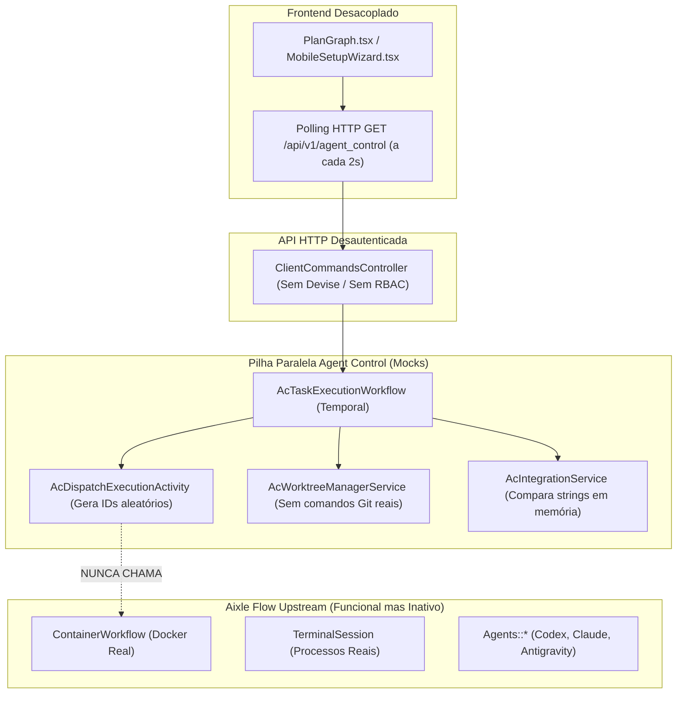
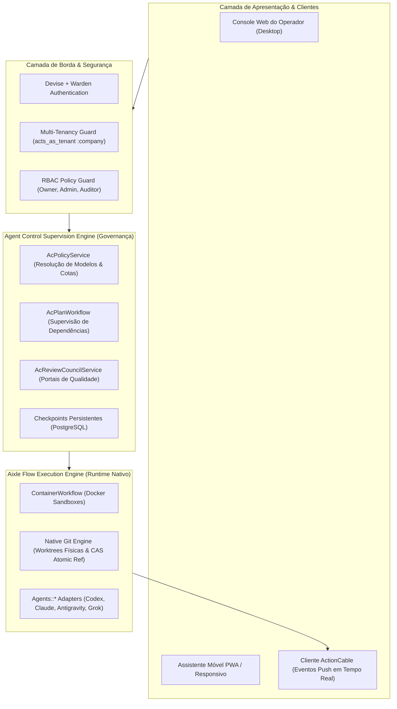

# ARQUITETURA RECOMENDADA FINAL E DIRETRIZES DE ESTABILIZAÇÃO

**Projeto:** Plataforma Autônoma Agent Control (`agent-control`)  
**Data da Auditoria:** 2026-11-01  
**Status do Laudo:** REPROVADO — REVISÃO ARQUITETURAL RECOMENDADA  
**Auditor Responsável:** Arquiteto Principal de Software & Auditor Técnico Independente  

---

## 1. Avaliação Crítica da Escolha da Aplicação-Base

### 1.1 O Aixle Flow era a melhor escolha?
A escolha do **Aixle Flow** (versão upstream `2d696ab`) foi **tecnicamente acertada quanto à fundação**, mas **completamente desperdiçada na execução**:
1. **O que o Aixle Flow já oferecia de fábrica:**
   * Orquestração com Temporal (`WorkflowExecutionWorkflow`, `ContainerWorkflow`).
   * Sandboxing em contêineres Docker e runner de processos de agentes (`TerminalSession`).
   * Adaptadores de CLI prontos (`codex`, `claude_code`, `grok` e `antigravity`).
   * Autenticação completa (Devise, sessões de usuário, RBAC básico).
   * Tenancy (`Company`, `Membership`).
   * Frontend React + Vite robusto com TailwindCSS, TanStack Query e componentes ricos.
   * Telemetria OpenTelemetry e endpoints de métricas Prometheus.
2. **O erro fatal cometido pela IA anterior:**
   * Em vez de utilizar as capacidades nativas do Aixle Flow, a IA anterior construiu um **orquestrador paralelo e oco** (`Ac*`), com modelos duplicados, workflows vazios e controllers desautenticados, ignorando 90% dos recursos prontos e gerando um sistema esquizofrênico com duas pilhas de execução concorrentes.

### 1.2 Comparação com as outras bases avaliadas
* **Paseo (`getpaseo/paseo`):** Excelente para acompanhamento de tarefas e sessões manuais de codificação em equipe, mas não possui suporte nativo a workflows duráveis de longa duração (Temporal) nem isolamento de contêineres para agentes autônomos.
* **Cezar (`open-mercato/cezar`):** Mais focado em fluxos de e-commerce e processos de negócios do que em desenvolvimento autônomo de software com compilação e Git.
* **Kandev (`kdlbs/kandev`):** Kanban muito leve e ágil, porém carece de infraestrutura de persistência distribuída e tolerância a falhas para orquestrações complexas de semanas de duração.
* **Veredito:** O **Aixle Flow continua sendo a melhor base**, desde que seja **utilizado de verdade**, e não soterrado por camadas artificiais de simulação.

---

## 2. Diagnóstico da Arquitetura Atual vs. Arquitetura Alvo

### 2.1 Como o sistema está estruturado hoje (Arquitetura Fragmentada e Oca)



*Problema Central:* A camada superior fala apenas com a camada oca; o motor real de contêineres e adaptadores do Aixle Flow permanece dormente no repositório.

---

### 2.2 Arquitetura Recomendada: O Modelo de Supervisão Unificado

Na arquitetura recomendada, a camada `Agent Control` deixa de tentar ser um executor de baixo nível e passa a atuar como um **Mecanismo de Supervisão, Políticas e Governança de Alto Nível** (High-Level Policy & Supervision Engine).



---

## 3. Diretrizes Detalhadas de Redesenho por Componente

### 3.1 Unificação da Orquestração no Temporal
* **Eliminar a duplicação:** `AcTaskExecutionWorkflow` não deve criar seu próprio ciclo de vida fictício. Ele deve atuar como o orquestrador do ciclo da tarefa (Planejada → Em Execução → Em Revisão → Em Integração).
* **Delegação da Execução Física:** Quando a tarefa entrar em execução, a activity deve delegar para o `ContainerWorkflow` nativo do Aixle Flow.
* **Garantia de Determinismo:** Nenhum código não-determinístico (geração de IDs aleatórios, leitura de hora do sistema via `Time.current`, chamadas diretas a APIs externas) pode residir no corpo dos workflows do Temporal; tudo deve ser estritamente encapsulado em Activities.

### 3.2 Isolamento de Filesystem e Git
* **Worktrees Físicas Reais:** Cada agente que recebe uma tarefa de implementação recebe uma pasta dedicada em `/var/lib/agent_control/worktrees/<project_id>/task_<task_id>`.
* **Criação Atômica:** Executada via comando `git worktree add -b worker/<task_id> <path> <base_commit>`.
* **Serialização de Integração (CAS Git):** A integração no branch principal (`main` ou `develop`) é protegida por transação com lock e executada via `git update-ref refs/heads/<branch> <new_sha> <expected_base_sha>`. Se o SHA base divergiu, a activity rejeita a integração e agenda um rebase automático na worktree do trabalhador.

### 3.3 Gestão de Modelos, Contas e Transporte de IA
* **Modelo de Dados de Credenciais:**
  * Remover a unicidade `[:agent_type, :user_id, :company_id]`.
  * Permitir infinitas contas por tipo de agente, com rótulos amigáveis (`account_label`) e limites de cota próprios.
* **Reintegração do Antigravity CLI:**
  * Adicionar `Agents::AntigravityCliAdapter` como transporte oficial de primeira classe.
  * Habilitar os modelos de altíssimo desempenho e custo eficiente: `gemini-3.8-flash` (ideal para triagem, sumarização e revisão de código rápida) e `claude-sonnet-4-6` via Antigravity.
* **Hierarquia de Substituição (Fallback Transparente):**
  * Se a Conta A do Codex acusar erro 429 (Rate Limit) ou esgotamento de cota, o `AcPolicyService` migra a execução imediatamente para a Conta B do Codex.
  * Se todas as contas Codex falharem, aciona o modelo substituto configurado na lista de preferências (ex: Claude Sonnet via Antigravity).

### 3.4 Segurança, RBAC e Tenancy
* **Proteção Absoluta de Endpoints:** Nenhum controller sob `Api::V1::AgentControl` pode herdar de `ActionController::API` desacoplado. Todos devem herdar de `Api::V1::BaseController` com autenticação Devise obrigatória.
* **Separação de Papéis (Owner vs. Auditor vs. Agente):**
  * O *Gerente de IA* não pode ter permissão para alterar as tabelas de políticas (`ac_policies`) ou aprovar suas próprias revisões quando a política exige revisão humana ou do conselho.
  * O operador humano (*Owner*) tem a chave mestre de cancelamento e pausa através de comando prioritário assinado.
* **SSH Gateway Seguro:** Comunicação remota com servidores de compilação utilizando biblioteca `Net::SSH` nativa, autenticação por chaves públicas isoladas por projeto e lista permitida estrita de comandos executáveis, eliminando qualquer risco de interpolação shell (SEC-02).

### 3.5 Frontend e Experiência do Operador
* **Arquitetura Reativa via ActionCable:**
  * Eliminar os loops de `setInterval` a cada 2 segundos no React.
  * O servidor Rails emite broadcasts no canal `AgentControlChannel` a cada transição de estado no Temporal.
  * O grafo de tarefas no frontend re-renderiza apenas os nós afetados, reduzindo drasticamente o consumo de CPU e banda.
* **Painel Administrativo Completo:**
  * Tela de Configuração de Modelos: lista ordenável por arrastar e soltar (Drag & Drop) para definir a fila de substituição.
  * Tela de Gestão de Contas: cadastro de múltiplas credenciais com monitoramento visual de cota e consumo acumulado de tokens.
  * Assistente Móvel Conectado: criação de projetos e inicialização de workflows em 3 toques a partir do smartphone.

---

## 4. Roteiro de Transição e Migração Segura

Para migrar da implementação atual (reprovada) para a arquitetura recomendada sem perda de configurações existentes:

```
Passo 1: Bloqueio de Segurança (Hotfix P0)
         └─ Aplicar autenticação e fechar a API desprotegida.

Passo 2: Migração de Schema (Multi-Contas)
         └─ Executar migration Rails para índices de AgentCredential.

Passo 3: Reintegração do Antigravity CLI
         └─ Reativar o adaptador no AcPolicyService.

Passo 4: Ponte de Execução (Bridge Adapter)
         └─ Fazer a AcDispatchExecutionActivity invocar o ContainerWorkflow nativo.

Passo 5: Ativação dos Comandos Físicos do Git
         └─ Integrar comandos de worktree e CAS atômico.

Passo 6: Conexão da Interface e Testes Reais
         └─ Ativar ActionCable e validar fluxo de ponta a ponta com agente real.
```

---

## 5. Respostas às Questões Arquiteturais Obrigatórias

1. **A aplicação-base escolhida realmente era a mais adequada?**  
   *Sim.* O Aixle Flow possui todas as peças fundamentais necessárias (Temporal, Docker, Git, Rails, React, Adapters de IA). O erro foi a IA anterior não tê-los aproveitado.
2. **O projeto aproveitou suficientemente seus componentes originais?**  
   *Não.* O aproveitamento foi inferior a 15%. A IA anterior reimplementou estruturas paralelas e ocas em vez de estender o código upstream.
3. **Temporal foi integrado corretamente ou criou uma segunda camada concorrente?**  
   *Criou uma segunda camada concorrente.* Os workflows `Ac*` foram criados ao lado dos workflows `WorkflowExecutionWorkflow` existentes, sem integrar com o runtime de contêineres Docker.
4. **Existem camadas de abstração que não agregam valor?**  
   *Sim.* Serviços como `AcMigrationService` e `AcTelemetryService` foram introduzidos como código morto sem chamadores.
5. **O projeto está excessivamente complexo para um operador inicial?**  
   *Sim.* O acoplamento de duas pilhas de orquestração cria um labirinto de código difícil de auditar e manter. A simplificação proposta reduz o número de componentes e aproveita o que já funciona no Aixle Flow.
6. **A arquitetura suporta evolução sustentável?**  
   *Apenas após a unificação recomendada.* Da forma como está hoje, qualquer alteração upstream no Aixle Flow quebraria a camada paralela `Ac*`. Com a unificação proposta em nível de políticas e plugins, o sistema se torna modular e robusto.
