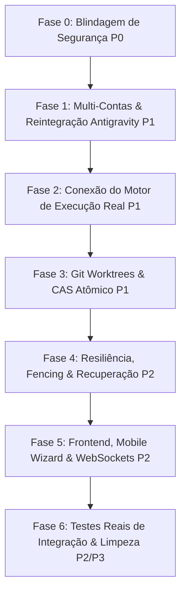

# PLANO DE CORREÇÃO PRIORIZADO E ROTEIRO DE ENGENHARIA

**Projeto:** Plataforma Autônoma Agent Control (`agent-control`)  
**Data da Auditoria:** 2026-11-01  
**Status do Laudo:** REPROVADO — REVISÃO ARQUITETURAL RECOMENDADA  
**Auditor Responsável:** Arquiteto Principal de Software & Auditor Técnico Independente  

---

## 1. Princípio de Engenharia: Não Corrigir o que Deve Ser Substituído

Um dos maiores erros em projetos em recuperação é investir esforço consertando componentes secundários que serão eliminados durante a reorganização arquitetural.

No caso do `agent-control`, a camada `Ac*` foi construída como uma casca oca em paralelo ao orquestrador nativo do Aixle Flow. O roteiro abaixo adota o seguinte princípio diretor:
1. **Primeiro**, neutralizar os riscos críticos de segurança (P0) que expõem o ambiente a invasões e RCE.
2. **Segundo**, desbloquear o modelo de dados de credenciais e IA (multi-contas e Antigravity), sem o qual a plataforma não tem matéria-prima para operar.
3. **Terceiro**, conectar as pontas do workflow diretamente ao motor nativo de contêineres e processos do Aixle Flow, eliminando as simulações vazias.
4. **Quarto**, implementar operações físicas reais de Git (worktrees isoladas e integração atômica CAS).
5. **Quinto**, conectar a interface visual e mobile ao backend e substituir testes de mock por testes reais de integração.

---

## 2. Mapa de Fases e Dependências



---

## 3. Detalhamento das Fases de Execução

---

### Fase 0 — Hotfixes Imediatos de Segurança (P0)
**Objetivo:** Eliminar vulnerabilidades de execução remota de código (RCE) e exposição de dados antes de qualquer outra atividade.

#### Ação 0.1: Fechamento de Autenticação e Tenancy na API
* **Problema Relacionado:** SEC-01, SEC-03
* **Arquivos Afetados:**
  * [app/controllers/api/v1/agent_control/application_controller.rb](file:///home/enok/Documentos/projetos/agent-control/app/controllers/api/v1/agent_control/application_controller.rb)
  * [app/controllers/api/v1/agent_control/client_commands_controller.rb](file:///home/enok/Documentos/projetos/agent-control/app/controllers/api/v1/agent_control/client_commands_controller.rb)
  * [app/controllers/api/v1/agent_control/plans_controller.rb](file:///home/enok/Documentos/projetos/agent-control/app/controllers/api/v1/agent_control/plans_controller.rb)
* **Mudança Técnica:**
  1. Alterar herança de `ApplicationController < ActionController::API` para o controller autenticado da aplicação base (`Api::V1::BaseController`).
  2. Aplicar `before_action :authenticate_user!` e verificação de tenant `current_company`.
  3. Escopar consultas ActiveRecord com `acts_as_tenant :company` em todos os controllers sob `api/v1/agent_control/*`.
* **Critério de Aceite:** Nenhuma requisição desautenticada consegue invocar `POST /api/v1/agent_control/client_commands` (retorna HTTP 401). Consultas retornam apenas registros da empresa do usuário autenticado (HTTP 403 para acessos cross-tenant).
* **Testes de Regressão:** Teste de controller validando requisições anônimas, com token inválido e de usuário de outro tenant.

#### Ação 0.2: Sanitização e Parametrização do Gateway SSH Remoto
* **Problema Relacionado:** SEC-02
* **Arquivo Afetado:**
  * [app/services/ac_remote_gateway_service.rb](file:///home/enok/Documentos/projetos/agent-control/app/services/ac_remote_gateway_service.rb)
* **Mudança Técnica:**
  1. Eliminar a concatenação manual de strings em `Open3.capture3`.
  2. Implementar sanitização obrigatória usando `Shellwords.shellescape` em todos os parâmetros recebidos.
  3. Adicionar validação de lista permitida (allowlist) de comandos remotos aceitos (ex: `git`, `bundle`, `npm`, `yarn`, `docker`).
* **Critério de Aceite:** Requisições contendo metacaracteres shell (`;`, `|`, `&&`, `$()`, `` ` ``) são rejeitadas ou escapadas sem execução paralela arbitrária no servidor remoto.
* **Testes de Regressão:** Teste unitário de segurança com payloads ofensivos comuns.

---

### Fase 1 — Multi-Contas e Reintegração do Antigravity CLI (P1)
**Objetivo:** Permitir a configuração de múltiplas contas por provedor (RF-05) e devolver ao operador o acesso aos modelos de topo via Antigravity CLI (Gemini 3.8 Flash e Claude Sonnet).

#### Ação 1.1: Migration de Remoção do Índice Único de Credenciais
* **Problema Relacionado:** AUTH-01
* **Arquivos Afetados:**
  * `db/migrate/[timestamp]_allow_multiple_credentials_per_agent_type.rb`
  * [app/models/agent_credential.rb](file:///home/enok/Documentos/projetos/agent-control/app/models/agent_credential.rb)
* **Mudança Técnica:**
  1. Criar migration Rails:
     ```ruby
     remove_index :agent_credentials, column: [:agent_type, :user_id, :company_id], if_exists: true
     add_column :agent_credentials, :account_label, :string, default: "default", null: false
     add_column :agent_credentials, :account_identifier, :string
     add_index :agent_credentials, [:agent_type, :account_identifier, :company_id], unique: true
     ```
  2. Atualizar validações no model `AgentCredential` para validar unicidade do par `[:agent_type, :account_identifier]` dentro do escopo `company_id`.
* **Critério de Aceite:** Um mesmo usuário consegue cadastrar duas credenciais com `agent_type: "codex"` diferenciadas por `account_identifier: "codex_personal"` e `"codex_work"`.

#### Ação 1.2: Revogação da ADR-002 e Reintegração do Antigravity CLI
* **Problema Relacionado:** LLM-01
* **Arquivos Afetados:**
  * [docs/decisions/ADR-002-antigravity-exclusion.md](file:///home/enok/Documentos/projetos/agent-control/docs/decisions/ADR-002-antigravity-exclusion.md)
  * [app/services/ac_policy_service.rb](file:///home/enok/Documentos/projetos/agent-control/app/services/ac_policy_service.rb)
* **Mudança Técnica:**
  1. Atualizar o status da ADR-002 para `SUPERSEDED BY ADR-003: ANTIGRAVITY REINTEGRATION`.
  2. Adicionar o transporte `antigravity` no catálogo de adaptadores válidos do `AcPolicyService`:
     ```ruby
     SUPPORTED_TRANSPORTS = %w[codex claude grok antigravity].freeze
     ```
  3. Mapear os modelos disponibilizados pelo Antigravity (`gemini-3.8-flash`, `claude-sonnet-4-6`) para os papéis de Supervisor, Programador e Revisor.
* **Critério de Aceite:** `AcPolicyService.resolve_model_for_role(:reviewer)` retorna o modelo de revisão rápida do Antigravity quando configurado nas preferências da empresa.

---

### Fase 2 — Conexão do Motor de Execução Real ao Aixle Flow (P1)
**Objetivo:** Substituir a geração de IDs aleatórios em `AcDispatchExecutionActivity` pela orquestração real de contêineres Docker e agentes de IA.

#### Ação 2.1: Substituição da Atividade Fictícia pelo ContainerWorkflow Nativo
* **Problema Relacionado:** EXEC-01, ARCH-01
* **Arquivos Afetados:**
  * [app/temporal/activities/agent_control/ac_dispatch_execution_activity.rb](file:///home/enok/Documentos/projetos/agent-control/app/temporal/activities/agent_control/ac_dispatch_execution_activity.rb)
  * [app/temporal/workflows/ac_task_execution_workflow.rb](file:///home/enok/Documentos/projetos/agent-control/app/temporal/workflows/ac_task_execution_workflow.rb)
* **Mudança Técnica:**
  1. Fazer com que `AcTaskExecutionWorkflow` invoque como sub-workflow o `ContainerWorkflow` ou `WorkflowExecutionWorkflow` nativo do Aixle Flow.
  2. Passar o payload real: repositório Git, worktree local, credencial de agente selecionada e prompt da tarefa.
  3. Capturar o resultado real de execução, código de saída e logs gerados pelo contêiner Docker do agente.
* **Critério de Aceite:** A tarefa só atinge o estado `completed` quando um processo de IA é executado, produz alterações no workspace e encerra com código de saída 0.
* **Testes de Regressão:** Execução de uma tarefa de teste simples (ex: criar um arquivo de documentação via agente) e validação da existência do arquivo gerado no filesystem.

---

### Fase 3 — Implementação de Git Worktrees e CAS Atômico de Integração (P1)
**Objetivo:** Garantir isolamento real no filesystem para múltiplos agentes simultâneos e serialização atômica de merges.

#### Ação 3.1: Alocação Física de Git Worktrees
* **Problema Relacionado:** GIT-01
* **Arquivo Afetado:**
  * [app/services/ac_worktree_manager_service.rb](file:///home/enok/Documentos/projetos/agent-control/app/services/ac_worktree_manager_service.rb)
* **Mudança Técnica:**
  1. Implementar a criação de worktrees físicas via subprocesso Git:
     ```ruby
     cmd = ["git", "-C", repo_path, "worktree", "add", "-b", branch_name, worktree_path, base_commit]
     stdout, stderr, status = Open3.capture3(*cmd)
     raise WorktreeAllocationError, stderr unless status.success?
     ```
  2. Implementar método de desalocação segura e limpeza: `git worktree remove --force <path>` com `FileUtils.rm_rf` de segurança.
* **Critério de Aceite:** Ao alocar uma worktree para uma tarefa, o diretório físico existe no disco, contém a cópia do projeto no commit base especificado e possui um branch Git dedicado.
* **Testes de Regressão:** Teste unitário alocando 3 worktrees simultâneas, verificando que alterações em uma não afetam as outras duas, e desalocando ao final.

#### Ação 3.2: Integração CAS Atômica com Advisory Locks
* **Problema Relacionado:** GIT-02
* **Arquivo Afetado:**
  * [app/services/ac_integration_service.rb](file:///home/enok/Documentos/projetos/agent-control/app/services/ac_integration_service.rb)
* **Mudança Técnica:**
  1. Adicionar lock de banco por repositório (`project.with_lock` ou Redis Distributed Lock).
  2. Utilizar o comando Git de Compare-And-Swap:
     ```bash
     git -C <repo_path> update-ref refs/heads/main <new_commit_sha> <expected_base_sha>
     ```
  3. Se a operação falhar (head avançou por outra integração), marcar a tarefa para rebase e nova validação pelo revisor.
* **Critério de Aceite:** Duas tarefas prontas para integração disputando o mesmo branch base são serializadas: uma é integrada com sucesso e a outra é notificada para rebase, sem perda de commits.
* **Testes de Regressão:** Teste de concorrência com duas threads tentando integrar simultaneamente sobre o mesmo commit base.

---

### Fase 4 — Resiliência, Fencing e Persistência de Desastre (P2)
**Objetivo:** Garantir que o sistema sobreviva a reinícios de processos, falhas de pods e mantenha autoridade estrita de liderança.

#### Ação 4.1: Persistência de Checkpoints de Recuperação no PostgreSQL
* **Problema Relacionado:** RES-01
* **Arquivo Afetado:**
  * [app/services/ac_recovery_service.rb](file:///home/enok/Documentos/projetos/agent-control/app/services/ac_recovery_service.rb)
* **Mudança Técnica:**
  1. Criar a tabela `ac_recovery_checkpoints` (`plan_id`, `cause`, `snapshot_data`, `status`, `created_at`).
  2. Eliminar o hash em memória `@active_recovery_contexts`.
  3. Fazer com que o boot da aplicação consulte registros de recuperação pendentes e retome o fluxo via Temporal Signal.
* **Critério de Aceite:** Matar o processo Rails (`kill -9`) durante uma recuperação em andamento e, após reiniciar o processo, verificar que o estado de recuperação é restaurado do banco.

#### Ação 4.2: Fencing Tokens com Lock Transacional
* **Problema Relacionado:** CONC-01
* **Arquivo Afetado:**
  * [app/services/ac_plan_service.rb](file:///home/enok/Documentos/projetos/agent-control/app/services/ac_plan_service.rb)
* **Mudança Técnica:**
  1. Utilizar `plan.with_lock` (`SELECT FOR UPDATE`) para incrementar e validar o `fencing_token`.
  2. Validar que requisições com fencing token anterior ao token persistido sejam sumariamente rejeitadas com erro de stale leader.
* **Critério de Aceite:** Um gerente antigo com token defasado tem seus comandos recusados imediatamente.

---

### Fase 5 — Frontend, Mobile Wizard e WebSockets (P2)
**Objetivo:** Tornar o assistente móvel funcional e substituir o polling ineficiente por comunicação bidirecional em tempo real.

#### Ação 5.1: Conexão do Mobile Setup Wizard ao Backend
* **Problema Relacionado:** UX-01
* **Arquivos Afetados:**
  * [app/controllers/api/v1/agent_control/client_commands_controller.rb](file:///home/enok/Documentos/projetos/agent-control/app/controllers/api/v1/agent_control/client_commands_controller.rb)
  * [app/frontend/pages/AgentControl/MobileSetupWizard.tsx](file:///home/enok/Documentos/projetos/agent-control/app/frontend/pages/AgentControl/MobileSetupWizard.tsx)
* **Mudança Técnica:**
  1. Adicionar o ramo `when "setup_project_wizard"` no `ClientCommandsController`.
  2. Invocar serviço de criação de projeto (`Project.create!`), configuração de repositório e vinculação de credenciais de agentes.
* **Critério de Aceite:** Ao concluir o assistente no smartphone, o projeto correspondente aparece imediatamente na lista de projetos ativos do usuário.

#### Ação 5.2: Streaming de Logs e Eventos via ActionCable
* **Problema Relacionado:** PERF-01
* **Arquivos Afetados:**
  * `app/channels/agent_control_channel.rb`
  * [app/frontend/pages/AgentControl/PlanGraph.tsx](file:///home/enok/Documentos/projetos/agent-control/app/frontend/pages/AgentControl/PlanGraph.tsx)
* **Mudança Técnica:**
  1. Criar o canal ActionCable para streaming de eventos de tarefas e planos.
  2. Remover `setInterval(fetchPlan, 2000)` do componente React e subscrever aos eventos de broadcast do canal.
* **Critério de Aceite:** Mudanças de estado de tarefas são refletidas na interface em menos de 100ms sem disparar requisições contínuas de HTTP GET.

---

### Fase 6 — Testes Reais de Integração e Limpeza de Código Morto (P2/P3)
**Objetivo:** Substituir os testes de falso positivo por testes de integração verdadeiros e remover código inútil.

#### Ação 6.1: Substituição de Mocks Circulares por Testes de Integração com Git Real
* **Problema Relacionado:** QA-01
* **Arquivos Afetados:**
  * [test/services/ac_worktree_manager_service_test.rb](file:///home/enok/Documentos/projetos/agent-control/test/services/)
  * [test/services/ac_integration_service_test.rb](file:///home/enok/Documentos/projetos/agent-control/test/services/)
* **Mudança Técnica:**
  1. Utilizar fixtures que inicializam repositórios Git temporários reais em `/tmp/test_repos/`.
  2. Validar que commits reais são gerados, merges são executados e conflitos são disparados no Git de verdade.
* **Critério de Aceite:** A suíte de testes de integração testa o comportamento real do Git e dos adaptadores sem nenhum mock de subprocesso.

#### Ação 6.2: Remoção ou Integração de Serviços Órfãos
* **Problema Relacionado:** CODE-01
* **Arquivos Afetados:**
  * [app/services/ac_migration_service.rb](file:///home/enok/Documentos/projetos/agent-control/app/services/ac_migration_service.rb)
  * [app/services/ac_telemetry_service.rb](file:///home/enok/Documentos/projetos/agent-control/app/services/ac_telemetry_service.rb)
* **Mudança Técnica:** Conectar a telemetria ao OpenTelemetry upstream ou remover os métodos não utilizados.

---

## 4. Matriz de Esforço, Criticidade e Prazos Sugeridos

| Fase | Ações Principais | Criticidade | Complexidade | Estimativa | Dependências |
| :--- | :--- | :---: | :---: | :---: | :--- |
| **Fase 0** | Fechamento de Segurança e Tenancy nos Controllers; Sanitização SSH | **P0** | Média | 1 a 2 dias | Nenhuma |
| **Fase 1** | Migração Multi-Contas de Credenciais; Reintegração Antigravity CLI | **P1** | Baixa | 1 dia | Fase 0 |
| **Fase 2** | Conexão de `AcDispatchExecutionActivity` ao ContainerWorkflow nativo | **P1** | Alta | 3 a 4 dias | Fase 0, Fase 1 |
| **Fase 3** | Implementação de Git Worktrees físicas e CAS Atômico de Integração | **P1** | Média | 2 a 3 dias | Fase 2 |
| **Fase 4** | Persistência de Checkpoints no PostgreSQL e Fencing com Redlock | **P2** | Média | 2 dias | Fase 3 |
| **Fase 5** | Assistente Móvel funcional e ActionCable WebSockets | **P2** | Média | 2 a 3 dias | Fase 2 |
| **Fase 6** | Suíte de Testes Reais e Limpeza de Código Órfão | **P2/P3** | Média | 2 dias | Todas |

**Tempo Total Estimado para Estabilização Completa:** ~13 a 17 dias úteis de engenharia focada.
