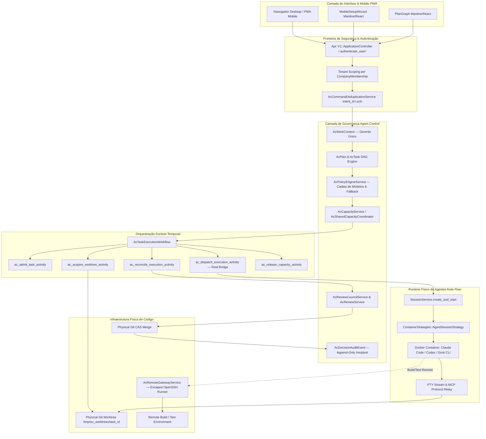

# Arquitetura Recomendada Final — Plataforma Agent Control

**Data:** 01 de Novembro de 2026  
**Auditor Responsável:** Arquiteto Principal de Software & Especialista em Sistemas Distribuídos  

---

## 1. Visão Arquitetural Consolidada

Após o diagnóstico forense detalhado, a recomendação categórica é **PRESERVAR a aplicação-base Aixle Flow e a camada de governança do Agent Control**, promovendo uma **UNIFICAÇÃO ESTRUTURAL (Bridge Architecture)** que elimine a duplicação concorrente e transforme a simulação atual em um sistema de produção autêntico.

### O que deve ser PRESERVADO:
1. **Aixle Flow como Fundação:** Base Apache-2.0 sólida em Ruby on Rails 8, com gerenciamento avançado de credenciais OAuth, pooling de containers Docker, terminal PTY interativo e integração nativa com Temporal;
2. **Camada de Governança e Políticas do Agent Control:** Modelagem relacional exemplar de políticas versionadas (`AcPolicyRevision`), contextos estáveis (`AcWorkContext`), divisão de tarefas em DAG (`AcPlan` / `AcTask`), auditoria append-only (`AcDecisionAuditEvent`), manifestos criptográficos (`AcBackupService`) e conselho de revisão em ondas (`AcReviewCouncilService`);
3. **Frontend Mantine / Inertia React:** Componentes visuais modernos (`PlanGraph.tsx` e `MobileSetupWizard.tsx`) com excelente estética visual e adequados para visualização desktop e mobile.

### O que deve ser DESCARTADO ou REFATORADO:
1. **Descarte da Simulação de Execução:** Eliminar as atividades de Temporal que geram handles aleatórios fictícios (`ac-proc-...`) sem executar processos;
2. **Descarte da Autenticação Aberta:** Extinguir o `Api::V1::AgentControl::ApplicationController` desprotegido com fallback `Company.first`;
3. **Descarte de Manipulação Fictícia de Git:** Substituir as meras strings de diretório por comandos Git físicos reais (`git worktree add`, `git merge`).

---

## 2. Diagrama da Arquitetura Unificada (Bridge Pattern)

---

## 3. Detalhamento dos Componentes da Arquitetura

### 3.1 A Ponte Entre a Governança e os Agentes (The Real Dispatch Bridge)
Em vez de reinventar a roda, a atividade de despacho `AcDispatchExecutionActivity` atuará como um **Adaptador de Domínio**:
1. Ela recebe o `ac_task_id` e a concessão de capacidade ativa;
2. Solicita ao `SessionService` do Aixle a criação de uma `TerminalSession` do tipo `agent`;
3. O `SessionService` provisiona um container Docker isolado (`docker/agents/claude-code` ou `docker/agents/codex-cli`);
4. As credenciais do usuário/empresa já gerenciadas pelo Aixle (`agent_credentials`) são montadas de forma segura no container;
5. O container roda o agente apontando para a worktree física criada pelo `AcWorktreeManagerService`;
6. Quando o agente termina de gerar os arquivos, a sessão encerra e devolve o código de saída e a lista de modificações ao workflow do Temporal.

### 3.2 O Ciclo de Vida Físico do Git
1. **Antes da Tarefa (Preparação):** O `AcWorktreeManagerService` executa:
   `git worktree add -b ac/task-123 /tmp/ac_worktrees/123 <base_commit>`
2. **Durante a Execução:** O container do agente edita diretamente o código dentro dessa worktree isolada;
3. **Na Revisão:** O revisor independente recebe o `diff` real gerado entre a branch da tarefa e a base;
4. **Na Aprovação:** O `AcIntegrationService` executa `git merge` condicional e deleta a worktree com `git worktree remove --force`.

### 3.3 Acesso Centralizado e Execução Remota Segura
- **Central Única:** Todas as chaves OAuth e assinaturas de IA ficam restritas à central (onde roda o Agent Control);
- **Servidores Remotos Limpos:** Os servidores remotos (ex.: ambientes de teste ou servidores de staging) recebem apenas o código via Git e comandos de build/teste via OpenSSH protegido;
- **Zero IAs Remotas:** Nenhum executável de IA ou credencial de API é instalado nos servidores remotos, cumprindo integralmente o requisito **RF-26**.

---

## 4. Sustentabilidade, Custos e Escalabilidade

1. **Economia Máxima de Tokens e Assinaturas:**
   - Com o pooling rigoroso de slots (`AcCapacityService` e `AcSharedCapacityCoordinatorService`), a plataforma garante que nenhuma conta tenha mais processos simultâneos do que sua cota oficial suporta;
   - As revisões em ondas de 2 vagas do conselho evitam o desperdício de tokens com avaliações redundantes.
2. **Manutenção do Fork em Relação ao Upstream:**
   - Como toda a governança do Agent Control reside em classes desacopladas (`app/models/ac_*`, `app/services/ac_*`, `app/temporal/*`), o repositório pode continuar recebendo atualizações de segurança e novos adaptadores de IA do upstream do Aixle Flow com risco quase nulo de conflitos de merge.
3. **Consumo de Hardware:**
   - A central necessita apenas de 4 a 8 vCPUs e 16GB de RAM para suportar múltiplos containers efêmeros de agentes, com o PostgreSQL lidando com a persistência transacional leve.
