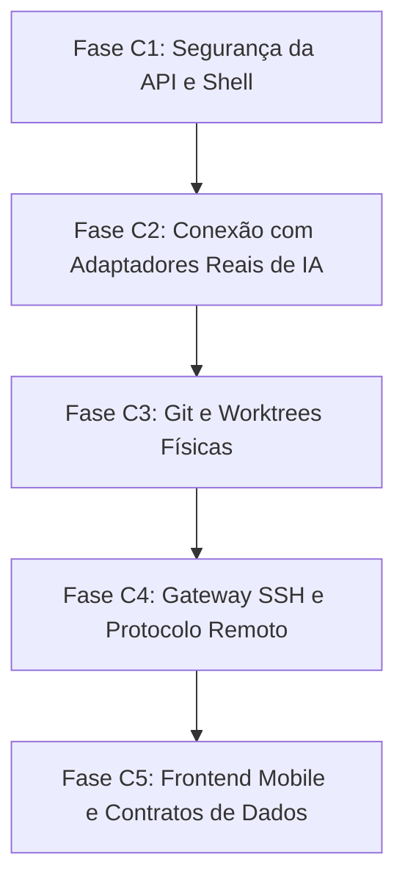

# Plano de Correção Priorizado e Roteiro de Engenharia — Agent Control

**Data:** 01 de Novembro de 2026  
**Auditor Responsável:** Arquiteto Principal de Software & Auditor Independente  
**Finalidade:** Guia passo a passo de engenharia para sanear todas as vulnerabilidades, conectar o runtime autônomo aos adaptadores reais e transformar a plataforma em um sistema robusto e pronto para produção.

---

## 1. Estratégia e Princípios da Correção

Para evitar retrabalho ou a correção de componentes que possam ser substituídos, o roteiro é organizado em **5 Fases Sequenciais Obrigatórias**:
1. **Fase C1 — Fechamento Imediato de Brechas de Segurança (P0):** Nenhuma execução de agente deve ocorrer com a API aberta ou comandos vulneráveis a injeção shell;
2. **Fase C2 — Conexão do Runtime de IA aos Adaptadores Reais (P0):** Substituir as atividades simuladas de Temporal pelo despacho real em containers e integração com os adaptadores existentes do Aixle Flow (`app/services/agents/`);
3. **Fase C3 — Isolamento Real de Git e Worktrees (P1):** Implementar o provisionamento físico de worktrees e operações reais de branch merge no Git;
4. **Fase C4 — Saneamento do Gateway SSH e Protocolo de Monitoramento (P1):** Corrigir o escape de argumentos e o arquivo de saída `.exit` para extinguir o bug dos jobs zumbis;
5. **Fase C5 — Alinhamento de Contratos de Frontend, UX e Auditoria (P1 e P2):** Corrigir o handler do Mobile Wizard, métodos do controller web e o contrato do DAG graph.

---

## 2. Roteiro Passo a Passo de Implementação



---

### Fase C1 — Fechamento Imediato de Brechas de Segurança (P0)

#### [C1.1] Autenticação e Multi-Tenancy Rigoroso na API
- **Problema Abordado:** `[DEF-02]`
- **Ações de Engenharia:**
  1. Alterar `Api::V1::AgentControl::ApplicationController` para herdar de `Api::V1::ApplicationController` (ou incluir `Authenticatable` e `Pundit::Authorization`);
  2. Remover a linha de fallback arbitrário `@company ||= ::Company.first`;
  3. Validar se `current_user.companies.where(id: requested_company_id).exists?` antes de atribuir `@company`;
  4. Retornar `401 Unauthorized` para requisições anônimas e `403 Forbidden` para tentativas de acesso cruzado de empresas.
- **Critério de Aceite:** Nenhuma chamada à rota `/api/v1/agent_control/*` responde com 200 sem token/cookie de autenticação válido.
- **Testes de Regressão:** `test/controllers/api/v1/agent_control/authorization_test.rb`.

#### [C1.2] Sanitização Shell no Gateway Remoto
- **Problema Abordado:** `[DEF-03]`
- **Ações de Engenharia:**
  1. Em `app/services/ac_remote_gateway_service.rb`, aplicar `Shellwords.shellescape` em `working_directory`;
  2. Desmembrar a invocação do comando remoto em argumentos protegidos, sem permitir concatenação aberta de strings.
- **Critério de Aceite:** Injeção de metacaracteres shell (ex.: `; ls -la`) é tratada como argumento literal ou rejeitada com erro de validação.

---

### Fase C2 — Conexão do Runtime de IA aos Adaptadores Reais (P0)

#### [C2.1] Refatoração da Atividade de Despacho (`AcDispatchExecutionActivity`)
- **Problema Abordado:** `[DEF-01]`
- **Ações de Engenharia:**
  1. No método `run` de `AcDispatchExecutionActivity`, buscar a tarefa `AcTask` e seu `AcExecutionProfile`;
  2. Mapear o `cli_adapter` e o `model_id` para o catálogo do Aixle Flow;
  3. Invocar `SessionService.create_and_start`:
     ```ruby
     session = SessionService.create_and_start(
       user: execution.ac_task.project.owner,
       project: execution.ac_task.project,
       company: execution.company,
       session_type: "agent",
       agent_type: profile.cli_adapter, # "claude_code", "codex", etc.
       params: {
         initial_prompt: execution.ac_task.build_execution_prompt,
         requested_model: profile.model_id,
         reasoning_effort: profile.effort_level
       }
     )
     ```
  4. Vincular o `session.id` e o `session.container_name` ao `execution.process_handle`.
- **Critério de Aceite:** O despacho de uma `AcTask` inicia um container Docker real (ou fake runtime em ambiente de teste de integração) com o processo da CLI de IA monitorado pelo Aixle.

#### [C2.2] Reconciliação Durável com Encerramento Real
- **Ações de Engenharia:**
  1. No `AcTaskExecutionWorkflow`, substituir o avanço cego imediato por uma espera assíncrona da conclusão da `TerminalSession` via sinal ou atividade de polling de status do container;
  2. Coletar o resultado real gerado pelo agente na worktree (diff de código e exit code da CLI);
  3. Atualizar a atividade `AcReconcileExecutionActivity` para só marcar sucesso se o agente produziu artefato válido.

---

### Fase C3 — Isolamento Real de Git e Worktrees (P1)

#### [C3.1] Implementação de Worktrees Físicas no Sistema de Arquivos
- **Problema Abordado:** `[DEF-05]`
- **Ações de Engenharia:**
  1. Em `AcWorktreeManagerService`, criar método `provision_physical_worktree!(execution)`:
     ```ruby
     system("git", "worktree", "add", "-b", branch_name, target_path, base_commit)
     ```
  2. Implementar a limpeza segura no `release_lease!`:
     ```ruby
     system("git", "worktree", "remove", "--force", target_path)
     system("git", "worktree", "prune")
     ```
  3. Garantir tratamento de erro em caso de conflito de lock de branch.
- **Critério de Aceite:** O diretório da worktree existe fisicamente no disco durante o ciclo de vida da execução e é limpo após a conclusão ou quarentena.

#### [C3.2] Integração Real de Branch no Repositório Git
- **Problema Abordado:** `[DEF-05]`
- **Ações de Engenharia:**
  1. Em `AcIntegrationService.integrate_task!`, após a validação lógica do CAS de branch, efetuar o merge real:
     ```ruby
     git_repo.merge_commit!(task.approved_commit_sha, into: current_branch_head)
     ```
  2. Obter o novo SHA de commit real gerado e registrar no histórico do projeto.

---

### Fase C4 — Saneamento do Gateway SSH e Protocolo de Monitoramento (P1)

#### [C4.1] Ajuste do Protocolo de Saída e Encerramento de Jobs Zumbis
- **Problema Abordado:** `[DEF-04]`
- **Ações de Engenharia:**
  1. No `AcRemoteGatewayService.dispatch_operation!`, encapsular o comando remoto para redirecionar o exit code:
     ```ruby
     remote_job_file = ".ac_job_#{remote_job_id}"
     wrapped_cmd = "cd #{Shellwords.shellescape(working_directory)} && ( #{command} ) > #{remote_job_file}.log 2>&1; echo $? > #{remote_job_file}.exit"
     ```
  2. Em `query_operation_status!`, se o arquivo `.exit` for encontrado, ler o código de saída e o arquivo de log para atualizar a operação como `completed` ou `failed`.
- **Critério de Aceite:** Jobs remotos desconectados são recuperados com precisão após o término sem ficarem presos no estado `running`.

#### [C4.2] Desacoplamento do Pin Estrito de Laboratório
- **Problema Abordado:** `[DEF-04]`
- **Ações de Engenharia:**
  1. Em `OpenSshTransport`, permitir que o `PIN_ALIAS` seja derivado do hostname/IP do ambiente cadastrado em `AcRemoteEnvironment`, sem forçar a string `"f0-lab-pinned"`.

---

### Fase C5 — Frontend Mobile, UX e Integridade de Auditoria (P1 e P2)

#### [C5.1] Correção do Handler no Mobile Wizard
- **Problema Abordado:** `[DEF-07]`
- **Ações de Engenharia:**
  1. Em `ClientCommandsController#handle_command`, adicionar a branch:
     ```ruby
     when "setup_project_wizard"
       project = Project.create!(company: current_company, name: payload["project_name"], owner: current_user)
       context = AcWorkContext.create!(company: current_company, project: project, title: payload["context_title"])
       # Configurar políticas e ambiente selecionado...
       { project_id: project.id, context_id: context.id, state: "configured" }
     ```
- **Critério de Aceite:** O envio do formulário no celular cria de fato os registros correspondentes no banco de dados.

#### [C5.2] Correção do Controller Web e Alinhamento de Contrato no DAG
- **Problemas Abordados:** `[DEF-06]`, `[DEF-09]`, `[DEF-10]`
- **Ações de Engenharia:**
  1. Em `Web::AgentControlController#wizard`, utilizar `current_company` em vez de `current_user&.company`;
  2. Em `PlanGraph.tsx`, alterar `attempts_count` para `attempt_count` para bater com a chave serializada pelo `AcDagGraphService`;
  3. Em `AcCutoverManagerService`, implementar a chamada correta para registrar o evento de cutover em `AcDecisionAuditEvent` sem usar `rescue nil`.

---

## 3. Estimativa de Esforço e Riscos de Regressão

| Fase | Complexidade Técnica | Risco de Regressão | Impacto no Upstream do Aixle Flow |
| :---: | :---: | :---: | :---: |
| **C1 (Segurança)** | Baixa | Mínimo | Zero (apenas proteção dos endpoints novos) |
| **C2 (Runtime IA)** | Alta | Médio | Positivo (reaproveita os containers nativos do Aixle) |
| **C3 (Git/Worktree)** | Média | Baixo | Zero (opera em diretórios isolados) |
| **C4 (SSH Gateway)** | Média | Mínimo | Zero (ajusta apenas o comando enviado) |
| **C5 (Mobile/UX)** | Baixa | Mínimo | Zero (correção de formulários e tipos) |
