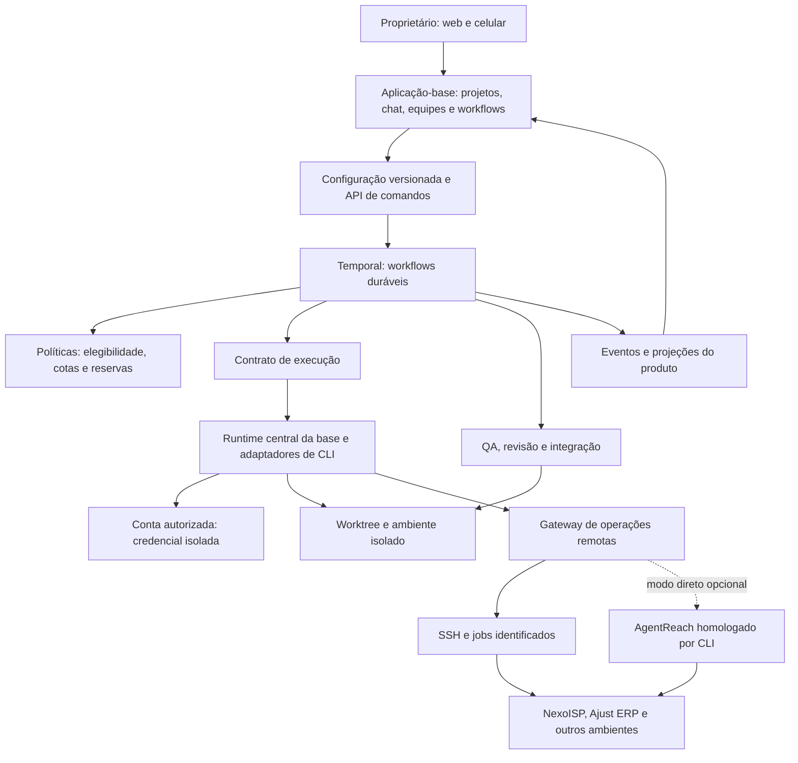
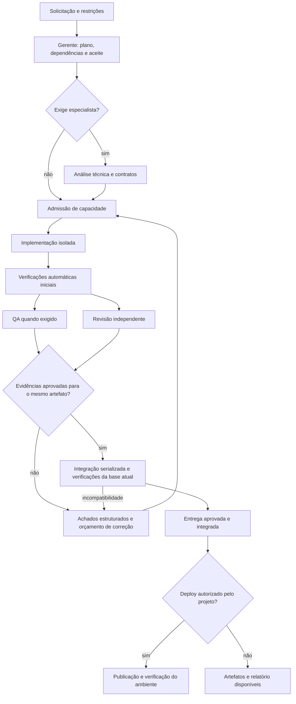

# Plano mestre — Plataforma central de desenvolvimento autônomo

**Versão:** 1.1 — revisão consolidada após dois pareceres de aprovação com condições  
**Data:** 31/10/2026, referência de horário America/Fortaleza  
**Responsável pela decisão de produto:** proprietário dos projetos  
**Finalidade:** consolidar visão, requisitos, arquitetura, escopo, desenvolvimento, validação e migração em um documento independente da conversa original.  
**Situação:** proposta revisada. Os dois pareceres aprovaram a direção e a avaliação inicial condicionada; os requisitos adicionais foram incorporados a esta versão. Isso não homologa a base, não equivale à aprovação desta revisão pelo proprietário e não autoriza desligar ou migrar os Paseos atuais. A versão 1.0 permanece preservada.

> **Proposta central:** aproveitar uma aplicação existente como produto-base, centralizar contas e execução das IAs, tornar políticas administráveis pelo celular e estabelecer um único motor durável para os workflows autônomos. Kandev é a base de trabalho proposta neste relatório, condicionada ao Gate G0. Aixle Flow é a alternativa estrutural prioritária e deve ter seu custo de adaptação comparado, mesmo se Kandev passar nos critérios eliminatórios. Cezar é candidato de reaproveitamento seletivo e alternativa de produto. Nenhum dos três será instalado como um segundo orquestrador concorrente.

## Sumário

1. [Decisão executiva e consenso proposto](#1-decisão-executiva-e-consenso-proposto)
2. [Contexto e problemas a resolver](#2-contexto-e-problemas-a-resolver)
3. [Evidências e avaliação das bases](#3-evidências-e-avaliação-das-bases)
4. [Visão, objetivos e resultados esperados](#4-visão-objetivos-e-resultados-esperados)
5. [Escopo e prioridades](#5-escopo-e-prioridades)
6. [Vocabulário e modelo de domínio](#6-vocabulário-e-modelo-de-domínio)
7. [Requisitos funcionais](#7-requisitos-funcionais)
8. [Requisitos não funcionais](#8-requisitos-não-funcionais)
9. [Papéis, modelos e regras de substituição](#9-papéis-modelos-e-regras-de-substituição)
10. [Arquitetura proposta e responsabilidades](#10-arquitetura-proposta-e-responsabilidades)
11. [Dados, contratos e consistência](#11-dados-contratos-e-consistência)
12. [Workflows, estados e recuperação](#12-workflows-estados-e-recuperação)
13. [Contas, credenciais e evidências de cota](#13-contas-credenciais-e-evidências-de-cota)
14. [Desenvolvimento central e execução remota](#14-desenvolvimento-central-e-execução-remota)
15. [Qualidade, revisão e integração](#15-qualidade-revisão-e-integração)
16. [Experiência web e celular](#16-experiência-web-e-celular)
17. [Permissões e autonomia](#17-permissões-e-autonomia)
18. [Observabilidade, métricas e comparação de modelos](#18-observabilidade-métricas-e-comparação-de-modelos)
19. [Plano de desenvolvimento e gates](#19-plano-de-desenvolvimento-e-gates)
20. [Plano de validação](#20-plano-de-validação)
21. [Migração e reversão](#21-migração-e-reversão)
22. [Operação e manutenção do fork](#22-operação-e-manutenção-do-fork)
23. [Riscos e decisões ainda abertas](#23-riscos-e-decisões-ainda-abertas)
24. [Definição de pronto](#24-definição-de-pronto)
25. [Parecer solicitado às IAs revisoras](#25-parecer-solicitado-às-ias-revisoras)
26. [Fontes e versões consultadas](#26-fontes-e-versões-consultadas)
27. [Consolidação dos pareceres e alterações da versão 1.1](#27-consolidação-dos-pareceres-e-alterações-da-versão-11)

## 1. Decisão executiva e consenso proposto

### 1.1 O que se propõe aprovar

- Uma única aplicação-base, aproveitada de verdade: frontend, backend, sessões, integrações e ambientes que atenderem aos contratos.
- Contas e CLIs de IA executadas no ambiente central, com isolamento entre projetos e contas.
- Administração visual de projetos, servidores, papéis, modelos, esforço, cotas, substituições e limites.
- Um gerente lógico por contexto de trabalho; vários trabalhadores e revisores independentes.
- Temporal como responsável pela progressão dos workflows autônomos da nova plataforma.
- Runtime da base responsável pelos processos dos agentes, subordinado ao contrato de execução.
- Serviço de políticas responsável por elegibilidade, capacidade e autorização; sem um segundo despachante de tarefas.
- Git worktrees e ambientes isolados como padrão de desenvolvimento.
- Operações remotas recuperáveis por SSH, com AgentReach como candidato para o modo de ferramentas remotas diretas.
- Migração por projeto/plano, preservando conversas, entregas e pausas explícitas.

### 1.2 Escolha de base e condição de reversão

**D-01 — Base de trabalho: Kandev, com adoção condicionada.** A justificativa é a prioridade dada pelo proprietário à administração visual, ao celular e à liberdade de configurar agentes. Aproveitar uma aplicação existente com essas superfícies pode reduzir o volume de produto novo. Sua arquitetura e seus pontos de extensão estão documentados ([S1](https://kandev.ai/docs/architecture); [S2](https://kandev.ai/docs/agents-and-profiles); [S5](https://kandev.ai/docs/mobile-remote-access); [S6](https://kandev.ai/docs/extending-kandev)). Isso não comprova que a integração necessária com Temporal seja pequena.

**D-02 — Alternativa estrutural: Aixle Flow.** A integração existente entre workflows, Temporal e containers é um argumento técnico forte. Se o Kandev não permitir que Temporal controle os workflows autônomos sem duplicar lançamento/retomada, ou exigir reescrever a maior parte do runtime, o Gate G0 deve recomendar Aixle Flow antes de investir em personalização extensa ([S8](https://github.com/AixleHQ/flow/blob/e6ec5a286120aed3a036d85871e796b2f6c97d70/README.md)).

**D-03 — Cezar: reaproveitamento seletivo condicionado à viabilidade.** Seu editor de grafos, representação de workflows e templates são candidatos. A extração precisa provar independência suficiente do backend original. Se importar esse editor trouxer junto outro motor de execução ou custar mais que componentes menores, utilizar a biblioteca de interface apropriada e adaptar somente o necessário. Não há compromisso de copiar a tela inteira ([S7](https://github.com/open-mercato/cezar/blob/cbcd733152fad62bc08b77df46777bbf72135205/README.md)).

**D-04 — Preservar a stack da base vencedora.** No caminho Kandev, manter Go e React/TypeScript; preferir Temporal Go SDK na integração nativa. Python pode hospedar temporariamente políticas reaproveitáveis. No caminho Aixle, preservar Rails/React e sua integração existente com Temporal. Não reescrever backend apenas para adotar FastAPI.

**D-05 — Distinguir consenso de homologação.** As propostas originais divergiam entre Kandev, Aixle e Cezar. Os dois pareceres sobre a v1.0 agora aprovam Kandev como primeiro candidato condicionado ao G0, preservando Aixle como alternativa. Existe consenso sobre a direção e a avaliação inicial; ainda não existe evidência de uma base definitivamente homologada. Produto/mobile, durabilidade, isolamento e custo de adaptação continuam decidindo a escolha.

**D-06 — Temporal e celular entram cedo.** A prova mínima de execução durável e o primeiro percurso móvel são anteriores ao editor visual completo e à equipe autônoma avançada. Adiar Temporal até depois de construir toda a automação criaria risco de refazer o núcleo.

### 1.3 O que não está aprovado por este documento

- Instalar a nova plataforma em produção ou iniciar migração de contas/tarefas.
- Alterar as regras atuais de modelos, ativar Astra ou contratar APIs pagas.
- Publicar credenciais, dados dos projetos ou conversas em um repositório público.
- Presumir que as capacidades anunciadas por qualquer candidato já foram homologadas.
- Presumir que apenas uma questão de licença poderia mudar a base. Compatibilidade de CLIs, isolamento, continuidade, mobile e custo de adaptação também podem inviabilizá-la.

### 1.4 Resultado da revisão externa

Os dois pareceres **aprovaram com condições** a visão, a arquitetura e o Kandev como primeiro candidato do G0. Nenhum homologou uma plataforma ou autorizou migração. Não foi solicitado outro ranking ou uma reconstrução do plano.

Esta versão aceita os ajustes de contratos e critérios: isolamento verificável entre contas; proteção integral de acesso; autoridade única em todos os pontos de entrada; prova SSH antecipada; vagas por etapa; capacidade comum durante a coexistência; evidência de testes produzida pelo executor; integração atômica; versionamento operacional; e visualização gráfica do progresso na P0. A matriz da seção 27 identifica origem, requisito, prova e gate de cada condição.

Duas distinções permanecem explícitas: o teto especial de oito programadores e dois revisores se refere à dependência exclusiva da **conta Codex original**, e não apenas à família GPT; incluir QA/especialista no pool de duas avaliações é proposta nova que exige definição antes da migração. Os pareceres não alteram as permissões nem os limites em operação.

A comparação Kandev/Aixle também deve justificar custo de adaptação quando ambos forem viáveis. A base selecionada recebe suas próprias provas de integração; aprovação de uma base não é transferida automaticamente para outra.

## 2. Contexto e problemas a resolver

O ambiente atual possui duas instalações personalizadas do Paseo: servidor principal, com projetos como Ajust_ERP e painel_provedores, e NexoISP, com NexoISP e Webchat. Cada servidor possui daemon, controlador e armazenamento local. Um broker central coordena parte da capacidade compartilhada das contas.

A operação já incorpora contas distintas, substituição por cota, isolamento de trabalhadores, revisão independente e concorrência. Parte dos incidentes observados nasceu na camada personalizada: instruções duplicadas, tickets divergentes, troca de identidade do gerente, operações com recibo perdido, visões incompletas do inventário e sincronização de evidências de cota. Portanto, mudar somente a interface não resolve as causas.

| Problema observado | Efeito para o proprietário | Resultado exigido na nova plataforma |
|---|---|---|
| Configuração espalhada por código, perfis e prompts | Depender de uma IA para mudar uma regra simples | Configuração visual, versionada e aplicada por um único contrato |
| Conversas confundidas com identidades de execução | Chat aparentemente vazio ou novo após troca de modelo | Histórico do produto independente da sessão nativa do provedor |
| Esgotamento misturado com erro de autenticação/transporte | Filas bloqueadas ou substituições erradas | Estados distintos, evidências e ações de recuperação específicas |
| Reenvio sem confirmação suficiente | Possibilidade de duplicação de agentes e tarefas | Operações idempotentes e reconciliação de resultados incertos |
| Vários projetos consumindo a mesma conta | Falta de previsibilidade da capacidade | Reserva global atômica e distribuição justa |
| Interface centrada em conversas | Dificuldade para descobrir o que está parado e por quê | Plano, execução, bloqueios, contas e próxima ação visíveis |
| Repetição de infraestrutura por servidor | Logins e manutenção duplicados | Execução central das IAs e destinos remotos cadastráveis |
| Revisões ou testes repetidos sem critério | Consumo e atraso evitáveis | Evidências reutilizáveis somente quando seus artefatos e condições ainda correspondem |

Este relatório não atribui todos os incidentes ao Paseo nem considera o código novo automaticamente mais confiável. Os comportamentos críticos precisam ser demonstrados na base escolhida.

## 3. Evidências e avaliação das bases

### 3.1 Como interpretar as afirmações

- **Vigente:** regra explicitamente definida pelo proprietário para a instalação atual.
- **Observado:** informação encontrada em configuração, código ou documentação; não equivale a teste operacional.
- **Proposto:** decisão de produto/engenharia deste relatório, sujeita ao parecer.
- **Pendente:** item que exige inspeção adicional ou execução controlada.

As consultas desta preparação foram estáticas e documentais. Nenhum dos candidatos foi instalado e homologado com as contas do proprietário durante a elaboração deste relatório.

### 3.2 Comparação orientada ao trabalho de adaptação

| Base | Evidência aproveitável | Incerteza decisiva | Tratamento |
|---|---|---|---|
| Kandev | Backend Go, interface web, runtime de agentes e extensões; controles de perfis e uso móvel ([S1](https://kandev.ai/docs/architecture); [S2](https://kandev.ai/docs/agents-and-profiles); [S5](https://kandev.ai/docs/mobile-remote-access); [S6](https://kandev.ai/docs/extending-kandev)) | Separar o ciclo de vida nativo do ciclo Temporal; recursos Office experimentais | Baseline proposta; verificar fronteira antes de personalização |
| Aixle Flow | Workflows e containers coordenados com Temporal, frontend React e adaptadores relevantes ([S8](https://github.com/AixleHQ/flow/blob/e6ec5a286120aed3a036d85871e796b2f6c97d70/README.md)) | Contas múltiplas, experiência móvel e semântica exata do ciclo de correção | Alternativa estrutural; comparar no G0 |
| Cezar | Editor/workflows, delegação, worktrees e acesso móvel ([S7](https://github.com/open-mercato/cezar/blob/cbcd733152fad62bc08b77df46777bbf72135205/README.md)) | Compatibilidade de toda a cadeia de CLIs e extração do editor sem importar o motor | Reuso seletivo; alternativa se demonstrar menor adaptação |
| Paseo atual | Regras reais, adaptadores próprios, incidentes e testes de regressão | Acoplamentos e duplicação de responsabilidades já observados | Fonte de contratos e migração; sem dependência obrigatória futura |
| AgentReach | Redirecionamento de operações para destinos remotos com agente na origem ([S11](https://github.com/bojieli/agentreach/blob/2fd182b7b953aeca6262c0586bf65e821afcc303/README.md)) | Compatibilidade por CLI/versão, integração com runtime e preservação de artefatos | Componente opcional por perfil; não motor de tarefas |

### 3.3 Correções às análises anteriores

**Gemini CLI não é Antigravity CLI.** O adaptador Gemini CLI do Aixle consultado restringe o caminho de autenticação a chave de API ([adaptador consultado](https://github.com/AixleHQ/flow/blob/e6ec5a286120aed3a036d85871e796b2f6c97d70/app/services/agents/gemini_cli_adapter.rb)). Porém, o adaptador Antigravity é distinto e documenta OAuth ([S10](https://github.com/AixleHQ/flow/blob/e6ec5a286120aed3a036d85871e796b2f6c97d70/app/services/agents/antigravity_cli_adapter.rb)). Hoje o proprietário utiliza Gemini e Sonnet através do Antigravity. Portanto, a limitação do primeiro adaptador não basta para concluir que Aixle não atende sua assinatura Google. É obrigatório verificar o caminho correto.

**Duas contas não são dois usuários artificiais.** A validação de `AgentCredential` no Aixle limita o tipo de agente por usuário/empresa no código consultado ([S9](https://github.com/AixleHQ/flow/blob/e6ec5a286120aed3a036d85871e796b2f6c97d70/app/models/agent_credential.rb)). O requisito é representar contas independentes explicitamente. Criar empresas fictícias para contornar isso não é a solução proposta.

**Office experimental não equivale a produto homologado.** A documentação do Kandev diferencia recursos estáveis e experimentais, e pode acompanhar código mais novo que as versões publicadas ([S3](https://kandev.ai/docs/feature-status)). O roteamento Office preserva identidade lógica, mas não transfere automaticamente a sessão nativa entre provedores ([S4](https://kandev.ai/docs/office-provider-routing)). O produto novo deve preservar o contexto útil por mecanismos próprios.

**SSH do aplicativo não significa IA central.** O executor SSH nativo do Kandev executa componentes e agente no destino ([S12](https://kandev.ai/docs/executors)). Ele não satisfaz sozinho o requisito de manter CLIs e autenticações centrais.

**AgentReach não resolve todos os contratos da plataforma.** Seus mecanismos variam conforme a CLI; redirecionar operações não implementa por si só reserva de conta, revisão, recuperação de workflow ou integração Git ([S11](https://github.com/bojieli/agentreach/blob/2fd182b7b953aeca6262c0586bf65e821afcc303/README.md)).

**Temporal não decide qualidade nem cota.** É necessário programar as regras de domínio e tornar repetíveis as operações externas. Uma Activity pode ser repetida quando sua confirmação não foi registrada ([S13](https://docs.temporal.io/activity-definition)).

**Fronteira de segurança da base não é isolamento automático.** A documentação do Kandev informa autenticação opcional, identidade administrativa sintética quando desabilitada e bind padrão em todas as interfaces. Também distingue isolamento de worktree de isolamento de credenciais/processos. Esses são fatos documentais, não um diagnóstico da instalação atual. O G0 deve provar o isolamento exigido aqui antes dos logins reais ([S14](https://kandev.ai/docs/security)).

**Interface de runtime não cobre automaticamente os caminhos legados.** No snapshot consultado, `Runtime` separa registro e início; `LaunchSpec` permite proprietário/admissão opcionais em lançamentos legados, e o arquivo informa acessos diretos a subcomponentes ainda existentes. É uma fronteira candidata, com trabalho de integração a investigar ([S15](https://raw.githubusercontent.com/kdlbs/kandev/997bc54fae4da15702c91da5c5d120bfe651edc1/apps/backend/internal/agent/runtime/runtime.go)).

### 3.4 Gate G0: decisão antes de um fork significativo

Critérios eliminatórios:

1. Executar as CLIs necessárias com as assinaturas corretas, sem substituição silenciosa por API paga.
2. Executar simultaneamente duas contas independentes do mesmo provedor, com identidade verificável e leitura cruzada de credenciais bloqueada tecnicamente.
3. Identificar todos os pontos de entrada e demonstrar, numa fatia mínima, autoridade única de admissão, lançamento, retomada e conclusão, inclusive após reinício ou confirmação perdida.
4. Preservar isolamento real e proteger UI, API, WebSocket, terminal e MCP, sem caminho direto de contorno; validar essa fronteira antes de inserir credenciais reais.
5. Demonstrar um percurso útil no celular, sem depender de um desktop conectado.
6. Ter licença e estratégia de distribuição compatíveis com o uso aprovado.
7. Demonstrar uma operação Git/teste via SSH, com IA autenticada somente na central, incluindo materialização de um repositório inicialmente acessível apenas pelo destino.

Depois de passar os eliminatórios, comparar o trabalho remanescente por evidência: superfícies de produto preservadas; mudanças invasivas no núcleo; adaptadores faltantes; complexidade do estado; manutenção de updates; extensão da migração. Registrar uma pontuação 0–5 somente com justificativa verificável, nunca preencher notas pela reputação do projeto.

Pesos propostos para essa comparação: contas/CLIs 20%; durabilidade e consistência 25%; produto/mobile 25%; extensibilidade e manutenção 15%; execução remota e isolamento 15%. Os pesos não anulam os critérios eliminatórios.

A saída do G0 é um ADR com a base escolhida, versão, evidências, lacunas e comparação explícita do custo de adaptação entre Kandev e Aixle, mesmo quando ambos forem viáveis. Não exige construir dois produtos: comparar primeiro as mesmas fronteiras e executar provas adicionais somente quando a incerteza afetar a escolha. A base finalmente selecionada precisa passar suas próprias provas de integração. Evidências independentes da base podem ser reutilizadas; lançamento, autorização, recuperação e interface não são homologados por analogia. Não reiniciar uma pesquisa geral de dezenas de produtos.

## 4. Visão, objetivos e resultados esperados

**Visão:** uma central autônoma de desenvolvimento em que o proprietário administra projetos, contas, equipes, planos e entregas pelo celular ou computador, utilizando suas assinaturas de IA e seus próprios servidores.

O chat será uma entrada para a mesma API utilizada pelo painel. Um pedido como “use esta conta como reserva do revisor” deve produzir uma alteração tipada, auditável e visível. Não deve instruir um agente a editar arquivos internos da instalação para realizar uma operação normal do produto.

Objetivos:

- O-01: reduzir configurações manuais repetidas por projeto e servidor.
- O-02: tornar seleção, substituição e espera explicáveis na interface.
- O-03: manter continuidade sem duplicação após falhas ou interrupções.
- O-04: aumentar paralelismo útil, respeitando dependências, recursos e contas.
- O-05: exigir qualidade verificável antes da integração.
- O-06: preservar autonomia, com permissões previamente configuradas e poucos pedidos repetidos.
- O-07: medir retrabalho e consumo sem confundir tokens, cache, cota e cobrança.
- O-08: manter capacidade de atualização da base open-source e reduzir remendos internos.

Sucesso é completar uma entrega real com evidências, recuperar cenários de falha definidos e administrar o processo pelo celular. Um painel bonito ou uma resposta textual afirmando “concluído” não satisfaz os critérios de entrega.

## 5. Escopo e prioridades

### 5.1 P0 — primeira versão utilizável e homologável

- Uma base existente preservada e uma instalação central para o operador confiável.
- Cadastro de projetos Git, destinos remotos e ambientes.
- Contas distintas, perfis de execução e as cadeias atuais de substituição.
- Gerente, programador e revisor; QA condicional e especialista sob demanda com políticas explícitas.
- Workflow autônomo durável com planejamento, implementação, verificação, revisão, correção e integração.
- Interface móvel para operações essenciais, inclusive configuração das políticas suportadas.
- Desenvolvimento em worktrees centrais isoladas e operações remotas persistentes.
- Evidências de execução, consumo, decisões e qualidade.
- Importação consultável do histórico atual e piloto com um projeto.
- Backup e restauração demonstrados; reversão de migração.

### 5.2 P1 — completar a liberdade de composição

- Editor livre de grafos no desktop e editor equivalente por etapas no celular.
- Modo de ferramentas remotas diretas por AgentReach/adaptador homologado.
- Templates especializados por tipo de projeto e importação/exportação sem segredos.
- Notificações push onde suportadas, com histórico de notificações independente da entrega push.
- Revisores paralelos e julgador como opção; não como padrão de todas as tarefas.
- Comparativos ampliados de modelos e políticas de distribuição mais refinadas.

A P0 deve permitir montar e alterar o fluxo suportado por formulários/etapas, além de visualizar seu grafo de execução somente de leitura, com estados reais, dependências, responsáveis e retornos de correção. O editor livre de grafos é uma entrega posterior sobre o mesmo contrato, sem mudança do modelo de execução. Se a extração do editor pronto provar baixo custo no G0, ela pode antecipar parte da P1.

### 5.3 P2 — evolução após evidência operacional

- Múltiplos operadores e organizações com isolamento formal entre clientes não confiáveis.
- Alta disponibilidade da central e pools adicionais de execução.
- Aplicativo móvel nativo, caso a experiência web instalada não seja suficiente.
- Marketplace de integrações e políticas avançadas.
- Execução completa de IAs em hosts remotos como modo adicional, aceitando seus requisitos próprios de autenticação.

### 5.4 Fora do escopo inicial

- Treinar modelos, criar uma nova CLI de IA ou vender capacidade de assinatura.
- Garantir correção absoluta do código ou operação sem qualquer necessidade de intervenção.
- Introduzir APIs pagas como fallback automático.
- Adicionar vários frameworks de agentes com responsabilidade concorrente.
- Reescrever toda a aplicação-base ou migrar todo seu armazenamento sem necessidade demonstrada.
- Executar alterações diretamente na árvore de produção como padrão de programação.

## 6. Vocabulário e modelo de domínio

Estas distinções são obrigatórias no banco, na API, nos logs e na interface. Elas evitam representar uma conta como se fosse um modelo ou recriar uma conversa a cada troca de provedor.

| Entidade | Significado e identidade |
|---|---|
| Projeto | Repositório, objetivos, ambientes, políticas de integração e autorização |
| Contexto de trabalho | Conversa persistente com um gerente lógico; pode conter vários planos ao longo do tempo |
| Plano | Versão de um objetivo dividido em tarefas, dependências, contratos e critérios de aceite |
| Tarefa | Unidade de entrega com escopo, entradas, saídas e verificação; independente do provedor que a executará |
| Tentativa | Uma execução autorizada de uma etapa da tarefa; identifica conta, modelo, esforço e versão da política |
| Operação | Ação externa identificável, como iniciar processo, executar teste ou integrar commit |
| Papel | Responsabilidade: gerente, especialista, programador, QA, revisor ou integrador |
| Perfil de execução | Combinação elegível de papel, CLI, modelo, esforço, permissões e critérios de seleção de conta |
| Conta | Identidade autenticada e assinatura; pode ser usada por vários perfis, compartilhando os limites reais |
| CLI/adaptador | Programa e protocolo que acessam a conta: Codex, Claude Code, Grok ou Antigravity |
| Modelo | Identificador aceito pela CLI; rótulo de exibição não substitui o identificador efetivo |
| Sessão nativa | Histórico próprio de uma CLI/provedor; não é a identidade oficial do chat no produto |
| Observação de cota | Evidência com origem, instante, escopo, validade e nível de confiança |
| Reserva de capacidade | Direito temporário de ocupar recursos, registrado atomicamente e associado a uma tentativa |
| Artefato | Commit, diff, log, relatório, arquivo ou resultado de teste com hash e proveniência |
| Parecer | Aprovação/reprovação de um artefato específico, por uma sessão independente |
| Ambiente remoto | Host, identidade SSH, diretórios, ferramentas, permissões e operações admitidas |
| Versão de política | Documento validado e imutável usado para explicar e reproduzir uma decisão |

Um projeto pode ter dois chats. Cada chat conserva seu gerente, mas a integração dos dois passa pelo mesmo controle do repositório. Não é aceitável resolver esse caso criando dois donos independentes da branch de entrega.

O contexto transferido entre provedores deve conter objetivo, restrições, decisões, tarefas, commits, resultados e pendências. Não se promete transferir o estado interno de uma sessão nativa entre ferramentas incompatíveis. A plataforma mantém o histórico útil mesmo quando precisa iniciar uma nova sessão nativa.

## 7. Requisitos funcionais

Prioridades: **P0** necessária para substituir a operação atual; **P1** próxima evolução; **P2** posterior. As fases e provas citadas estão nas seções 19 e 20.

| ID | Requisito verificável | Prioridade |
|---|---|---|
| RF-01 | Cadastrar projeto, repositório, branch, ambientes e diretórios autorizados pelo painel | P0 |
| RF-02 | Administrar vários projetos e destinos em uma única central | P0 |
| RF-03 | Criar contextos com histórico estável, preservado ao trocar conta, modelo e CLI | P0 |
| RF-04 | Manter exatamente um gerente ativo autorizado por contexto | P0 |
| RF-05 | Representar duas contas do mesmo provedor sem usuários/empresas artificiais | P0 |
| RF-06 | Autenticar por mecanismos oficiais de assinatura, sem API paga silenciosa | P0 |
| RF-07 | Configurar papel, perfil, esforço, conta, prioridade e substituições visualmente | P0 |
| RF-08 | Validar catálogo e combinações antes de publicar uma política; rejeitar modelo/esforço inexistente | P0 |
| RF-09 | Exibir versão aplicada e explicar por que um perfil foi escolhido ou recusado | P0 |
| RF-10 | Distinguir cota esgotada, limite temporário, autenticação inválida, falha de rede e estado desconhecido | P0 |
| RF-11 | Respeitar permanência de trabalhador regular e devolução da reserva emergencial | P0 |
| RF-12 | Retomar automaticamente espera por capacidade quando houver evidência válida, preservando pausa humana | P0 |
| RF-13 | Reservar capacidade global e local atomicamente, sem contar a mesma conta duas vezes | P0 |
| RF-14 | Distribuir vagas entre chats com prioridade e justiça, evitando fome indefinida | P0 |
| RF-15 | Gerar planos versionados com dependências, contratos de entrada/saída e critérios de aceite | P0 |
| RF-16 | Executar tarefas independentes em paralelo e serializar dependências e integrações incompatíveis | P0 |
| RF-17 | Consultar especialista antes da implementação quando o risco justificar | P0 |
| RF-18 | Executar QA e revisão independentes, quando exigidos pelo template da tarefa | P0 |
| RF-19 | Vincular pareceres e verificações a commits e condições exatos, invalidando evidência incompatível | P0 |
| RF-20 | Retornar uma entrega reprovada à implementação, preservando achados e exigindo nova avaliação | P0 |
| RF-21 | Limitar ciclos de correção e recuperar falhas técnicas sem loops ilimitados de consumo | P0 |
| RF-22 | Usar workflow durável para despacho, esperas, cancelamento e conclusão | P0 |
| RF-23 | Reconciliar reinícios, confirmações perdidas e processos órfãos antes de repetir efeitos | P0 |
| RF-24 | Pausar, retomar, cancelar e drenar com semânticas distintas e visíveis | P0 |
| RF-25 | Integrar somente artefato aprovado, com proteção contra tentativa antiga e mudança da base | P0 |
| RF-26 | Executar CLIs na central e operações autorizadas em dois servidores sem logins de IA nesses destinos | P0 |
| RF-27 | Preservar identidade e resultado de uma operação SSH após desconexão | P0 |
| RF-28 | Isolar worktrees, processos, credenciais e redes conforme o perfil | P0 |
| RF-29 | Oferecer capacidade administrativa autorizada ao gerente sem repassá-la ao trabalhador | P0 |
| RF-30 | Exibir uso, cota e renovação por conta quando observáveis; indicar desconhecido quando não observáveis | P0 |
| RF-31 | Produzir auditoria de decisões, trocas, tentativas, revisão, integração e intervenção humana | P0 |
| RF-32 | Permitir os percursos essenciais de configuração e operação pelo celular | P0 |
| RF-33 | Importar histórico, planos e evidências dos Paseos sem duplicar trabalho concluído | P0 |
| RF-34 | Exportar configuração e relatórios sem credenciais; oferecer backup e restauração | P0 |
| RF-35 | Notificar conclusão agrupada e bloqueio relevante, com deduplicação e histórico | P0 |
| RF-36 | Alterar configuração pelo chat usando a mesma API validada do painel, sem edição livre de arquivos internos | P0 |
| RF-37 | Oferecer editor livre de grafos e editor móvel equivalente por etapas | P1 |
| RF-38 | Permitir equipe com vários revisores e julgador dentro dos limites compartilhados | P1 |
| RF-39 | Operar diretamente em worktree remota via adaptador homologado, com consistência de artefatos | P1 |
| RF-40 | Coletar e exportar uso, perfil, tentativas, tempo e retrabalho corretamente; oferecer comparação simples com limitações explícitas. Análises estatísticas/painéis avançados ficam em P1 | P0/P1 |
| RF-41 | Separar aprovação da entrega, integração, publicação e deploy em permissões diferentes | P0 |
| RF-42 | Validar edição concorrente de políticas e disponibilizar reversão para uma versão anterior | P0 |
| RF-43 | Cadastrar templates reutilizáveis por projeto sem duplicar os dados de contas globais | P0 |
| RF-44 | Preservar pausas e bloqueios explícitos durante importação, reinício e recuperação de cota | P0 |
| RF-45 | Exigir a mesma autorização de tentativa/capacidade em painel, chat, MCP, automação, retry, fallback e recuperação | P0 |
| RF-46 | Compartilhar autoridade de admissão e renovação de credenciais entre antigo/novo durante migração e reversão, ou impedir sobreposição de contas | P0 |
| RF-47 | Reservar recursos por execução de etapa e liberar os correspondentes após encerramento reconciliado, sem bloquear avaliação por retenção de worktree | P0 |
| RF-48 | Aceitar evidências de verificação apenas do executor confiável e condicionar atomicamente a integração à base esperada | P0 |
| RF-49 | Impedir acesso cruzado entre contas e acesso de agentes à administração da central por arquivos, processos e APIs | P0 |
| RF-50 | Exibir grafo de execução somente de leitura com estado, dependências, agentes, falhas e correções no desktop e celular | P0 |
| RF-51 | Materializar com segurança um projeto Git inicialmente acessível somente por SSH, sem exigir GitHub ou login de IA no destino | P0 |
| RF-52 | Atualizar workers/workflows com estratégia de versões e restaurar a central em modo de reconciliação sem despacho automático | P0 |
| RF-53 | Deduplicar comandos móveis e reconexões pela identidade da intenção, independentemente da entrega HTTP/WebSocket | P0 |
| RF-54 | Garantir um único escritor autorizado por worktree e neutralizar acesso antigo antes de compartilhar a mesma cópia com nova tentativa | P0 |

## 8. Requisitos não funcionais

Os números abaixo são metas propostas de homologação, não desempenho já medido.

| ID | Requisito | Critério |
|---|---|---|
| RNF-01 | Continuidade | Reiniciar componentes não perde comandos confirmados nem autoriza uma segunda execução incompatível |
| RNF-02 | Consistência | Um único proprietário por transição de estado; efeitos externos reconciliados e integração protegida por identidade/época |
| RNF-03 | Isolamento | Trabalhador não acessa conta alheia, chave administrativa, Docker socket ou diretório de outro projeto |
| RNF-04 | Experiência móvel | Fluxos essenciais utilizáveis em telas de 360 e 390 px de largura, além do desktop; sem dependência de hover |
| RNF-05 | Observabilidade | Toda tarefa parada informa motivo, evidência, responsável pela recuperação e próxima condição de avanço |
| RNF-06 | Manutenibilidade | Adaptadores, políticas e workflows com contratos e versões; patch invasivo documentado em ADR |
| RNF-07 | Eficiência | Eventos agrupados, contexto selecionado e verificações reutilizadas apenas sob identidade compatível |
| RNF-08 | Segurança de dados | Segredos não aparecem em histórico Temporal, conversa, log exportável, prompt ou artefato |
| RNF-09 | Reprodutibilidade | Versões da base, CLI, modelo, política, imagem e código identificadas em cada tentativa |
| RNF-10 | Recuperação operacional | Backup com restauração demonstrada; meta inicial de desastre RPO até 24 h e RTO até 2 h, a confirmar no piloto |
| RNF-11 | Capacidade | Admissão considera memória, CPU, disco, vagas e contas; fila saudável substitui lançamento acima da capacidade |
| RNF-12 | Responsividade | Meta inicial: aceite de comando em até 2 s e atualização de evento em até 5 s no ambiente homologado; autenticação/provedor externos medidos separadamente |
| RNF-13 | Compatibilidade | Atualização de CLI ou modelo passa por contrato de protocolo antes de virar padrão |
| RNF-14 | Transparência | Cota não observada nunca é apresentada como disponível ou percentual estimado sem identificação |
| RNF-15 | Portabilidade | Planos, políticas, histórico e evidências exportáveis; credenciais tratadas em procedimento separado |

RPO de desastre não significa que um reinício normal possa apagar 24 horas. O estado persistido e confirmado deve sobreviver ao reinício. Perda total de armazenamento exige restaurar os backups e reconciliar efeitos externos posteriores.

## 9. Papéis, modelos e regras de substituição

### 9.1 Separar comportamento de identidade de modelo

A arquitetura deve permitir alterar modelos pela interface. A configuração inicial, entretanto, precisa respeitar as decisões vigentes; não começar com uma equipe diferente porque o framework tem defaults próprios.

A tabela abaixo é a **semente de migração**, baseada nas regras vigentes e na configuração consultada nesta preparação. Não afirma disponibilidade de cota neste instante. Identificadores e compatibilidade precisam ser validados contra as CLIs instaladas no G0.

| Papel | Principal | Substituição | Regra de retorno |
|---|---|---|---|
| Gerente | Conta Codex original, GPT-6.1 Sol Médio, com Alto adaptativo | Claude Sonnet 5.5 Alto | Retorna ao principal após recuperação confirmada, em fronteira segura |
| Programador regular 1 | Grok 4.7 Médio, CLI oficial | Regular 2 | Regular selecionado permanece enquanto elegível |
| Programador regular 2 | Conta Codex exclusiva de programação, GPT-6.1 Sol Médio | Regular 3 | Mesma regra de permanência |
| Programador regular 3 | Gemini 3.8 Flash Alto, conta lógica Gemini 3 via Antigravity | Regular 4 | Mesma regra de permanência; cota específica do modelo |
| Programador regular 4 | Sonnet 5.5 Médio via Antigravity, na conta habilitada para esse acesso | Reserva emergencial | Mesmo transporte/conta não implica mesma janela de cota do Gemini |
| Programador emergencial | Conta Codex original, GPT-6.1 Sol Médio | Aguarda capacidade elegível | Devolve as próximas tarefas quando um regular recupera capacidade confirmada |
| Revisor | Claude Sonnet 5.5 Alto | Codex original, Sol Médio com Alto adaptativo; depois Grok 4.7 Alto | Retorna ao principal em fronteira segura |
| QA independente | Perfil configurável de avaliação, definido no template | Cadeia de avaliação explicitamente configurada | Proposta nova; não pressupõe papel QA já implementado hoje |
| Especialista técnico | Perfil configurável para análise anterior à execução | Perfil explicitamente configurado | Convocação pontual, sem se tornar segundo gerente |

**Regras obrigatórias da semente:**

- Astra permanece desabilitado. A exceção histórica foi revogada; não deve reaparecer durante a migração.
- Nenhum esforço acima de Alto. Não habilitar Ultra, xhigh ou equivalentes por default.
- Terra não integra a cadeia ativa inicial: permanece apenas no histórico comparativo.
- Opus não retorna à gerência apenas por ter sido usado anteriormente.
- A conta Codex exclusiva de programação não passa a financiar gerente/revisor implicitamente.
- CLI oficial do Grok permanece o caminho escolhido. Não introduzir OpenCode como desvio automático.
- Somente a conta Gemini habilitada é importada como ativa. Contas removidas não reaparecem por descoberta de diretórios antigos.
- Usar Sonnet via Antigravity não equivale a usar a assinatura Claude Code. São contas/transportes e evidências separados.
- Revisão e implementação nunca utilizam a mesma sessão. Para implementação por Sonnet via Antigravity, preservar a preferência vigente por revisão Sol quando elegível, evitando depender do mesmo modelo para produzir e avaliar essa entrega.

Há aliases legados na configuração, inclusive referências históricas a Terra em metadados de ordenação. A migração deve normalizar referências pelos IDs reais e pela cadeia aprovada, não copiar arquivos e presumir que todos os rótulos estão atualizados.

### 9.2 Esforço adaptativo

O Sol da gerência usa Médio para acompanhamento, distribuição e atualizações comuns. Alto é permitido em planejamento complexo, conflitos de integração e bloqueios técnicos repetidos. O Sol revisor usa Médio por padrão e Alto quando houver criticidade, complexidade estrutural, arquivos sensíveis, alteração destrutiva ou achados relevantes anteriores.

Essa decisão deve registrar motivo, escopo e duração. A escalada vale para a operação necessária; não torna todos os turnos futuros permanentemente Altos. Limiares configuráveis e conservadores evitam depender apenas da autoavaliação do próprio agente.

### 9.3 Permanência, substituição e devolução

1. Selecionar o primeiro perfil elegível da cadeia quando não houver escolha regular saudável preservada.
2. Se um trabalhador regular já está selecionado e disponível, não interrompê-lo porque um perfil anterior recuperou cota.
3. Esgotamento confirmado fecha novas admissões naquela combinação de conta/escopo e encaminha a etapa pendente ao próximo perfil.
4. O trabalho recuperado recebe pacote de contexto, worktree reconciliada e nova identidade de tentativa quando necessário. Não fingir continuação da mesma sessão entre CLIs.
5. A reserva Codex original só entra quando a condição de emergência autorizada estiver confirmada. Desconhecimento ou erro de login não pode ser registrado falsamente como esgotamento.
6. Quando um regular volta, a reserva conclui a entrega saudável em curso e deixa de receber novas tarefas. Não cancelar código em andamento apenas para trocar o rótulo.
7. Gerente e revisor têm retorno ao principal, diferentemente da permanência dos trabalhadores regulares. A troca ocorre entre operações/turnos e pareceres, com exclusão mútua.
8. Todas as opções indisponíveis geram espera explicada. A recuperação retoma somente planos habilitados, nunca uma pausa do operador.

Se uma conta estiver desabilitada pelo operador, ela sai do conjunto elegível. Indisponibilidade por autenticação ou transporte pode permitir usar outro regular, mas não deve disparar a reserva financeira emergencial como se a cota tivesse acabado. Ampliar essa condição é uma alteração explícita de política.

### 9.4 Limites e justiça entre chats

A versão 1.0 misturava o provedor GPT com a identidade da conta. Esta revisão separa a regra pretendida do inventário histórico. A tabela é a semente a registrar no ADR de migração; não é uma nova auditoria ou aplicação da configuração ativa:

| Condição | Limite da semente | Escopo |
|---|---|---|
| Operação normal com provedores disponíveis | Até 10 trabalhadores por chat; 1 gerente separado | Ainda sujeito à capacidade do host e das contas |
| Operação em que todos os papéis dependem exclusivamente da conta Codex original | Até 8 programadores e 2 revisores simultâneos | Compartilhados globalmente entre servidores e chats; condição baseada na conta, não na família de modelos |
| Gerência | 1 gerente por chat ativo | Compartilha a cota real da conta, sem criar cota adicional |

**Correção de DA-07:** Codex original e Codex dedicado disponíveis simultaneamente não satisfazem a condição “somente a conta original”, mesmo que todos executem GPT. Não aplicar automaticamente o teto especial a esse cenário. O ADR deve nomear os IDs reais das contas, definir a entrada/saída do modo de dependência exclusiva e conferir a implementação ativa antes da importação. O teto normal por chat e a inclusão de novos papéis permanecem itens de configuração a confirmar; não reinterpretar “8” como oito por chat nem como restrição de todos os modelos GPT. Nenhum limite ativo está sendo alterado por este documento.

**Proposta para os novos papéis:** QA e especialistas, quando executados como agentes adicionais, consomem vagas do pool de avaliação e do teto de trabalhadores do chat. Não criam vagas extras fora da política. Na proposta para o modo exclusivo da conta original, o teto de duas avaliações inclui revisores/QA/especialistas; gerentes continuam separados. Esse detalhe é novo e deve receber parecer explícito.

Exemplo com oito vagas globais de programação, tarefas elegíveis suficientes, prioridades iguais e capacidade física suficiente:

| Chats ativos | Distribuição ilustrativa |
|---|---|
| 1 | Até 8 para o chat |
| 2 | Até 4 para cada |
| 3 | 3 / 3 / 2, alternando a vantagem ao longo do tempo |
| 4 | Até 2 para cada |
| Mais de 8 | Rodízio das vagas, sem interromper tentativas saudáveis |

A distribuição não deve ser uma divisão estática: vagas ociosas são emprestadas; novas concessões consideram espera, prioridade e uso recente. Duas revisões não ficam presas a um chat específico. Revisão e gerência têm precedência operacional para encerrar entregas, com envelhecimento de prioridade para a programação também avançar.

O limite é teto, não obrigação de abrir oito ou dez processos. Dependências, memória, espaço, custo e tamanho útil das tarefas podem exigir menos. Um modelo em execução não equivale a uma conta com capacidade ilimitada.
### 9.5 Vagas por etapa, sem dependências circulares

A concessão de inferência/processo pertence à execução de uma etapa, não à tarefa inteira até o merge. Ao terminar e reconciliar a implementação, liberar suas vagas de programação/execução; manter worktree, logs e artefatos sob reservas próprias de disco. QA e revisão obtêm concessões independentes dentro dos limites definidos.

Não manter programadores ociosos ocupando todas as vagas enquanto aguardam um revisor que precisa dessas mesmas vagas. Um especialista convocado durante uma execução exige admissão conjunta, capacidade já reservada ou suspensão efetiva/reconciliada do chamador antes da espera. Suspender apenas o texto da conversa não libera memória, processo ou inferência.

A liberação é por tipo de recurso: processo comprovadamente encerrado libera sua vaga; artefato retido continua consumindo disco; processo incerto mantém bloqueados os recursos que ainda pode consumir. A política de justiça não cria uma exceção para ultrapassar o teto. T29 verifica saturação e ausência dessa espera circular.

## 10. Arquitetura proposta e responsabilidades

### 10.1 Visão lógica



“Temporal despacha trabalhadores” significa que o workflow solicita operações a Activities e aguarda resultados duráveis. O workflow não executa diretamente CLI, SSH, consulta de cota, inferência de IA ou acesso arbitrário a arquivos. Essas operações ficam nos componentes de execução.

### 10.2 Responsabilidades exclusivas

| Componente | Deve fazer | Não deve decidir independentemente |
|---|---|---|
| Aplicação-base | Identidade, interface, projetos, conversas, configuração, comandos e leitura de status | Repetir lançamento porque a tela não recebeu resposta |
| Temporal | Progressão, dependências, esperas, ciclos, cancelamento coordenado e conclusão | Inventar política de cota ou aprovar qualidade |
| Serviço de políticas | Seleção elegível, orçamento/capacidade, concessão, renovação e auditoria | Avançar sozinho a tarefa para implementação ou revisão |
| Runtime/adaptador | Iniciar, observar, interromper e reconciliar o processo autorizado | Criar nova tentativa ou mudar de conta por conta própria |
| Gateway remoto | Executar operação autorizada e consultar seu resultado persistido | Interpretar ausência de conexão como prova de que nada foi executado |
| Integrador | Validar pareceres, bloquear concorrência e aplicar artefato exato | Trocar silenciosamente o commit aprovado por outro |
| Gerente IA | Planejar, dividir, priorizar e propor mudanças dentro das ferramentas autorizadas | Editar banco interno para contornar uma regra ou se autoconceder outra conta |

Para os planos controlados por Temporal, os mecanismos nativos de autoavanço, fallback, Office e retry da base que disputem essas decisões devem ser desabilitados ou subordinados ao contrato. A supervisão de um processo pode permanecer no runtime; uma nova tentativa de negócio pertence ao workflow.

### 10.2.1 Cobertura de todos os pontos de entrada

Toda execução administrada passa pelo mesmo contrato de tentativa, concessão e época: UI, chat, API, MCP, agendamentos, retomada, fallback, recuperação e ferramentas de administração. O runtime recusa início/retomada de trabalho gerenciado sem autorização válida, inclusive quando o pedido chega por um caminho legado. Uma etiqueta de “manual” não é escape para consumir a conta fora da reserva.

G0 inventaria chamadores diretos e prova uma fatia dessa fronteira. G2 cobre todos os caminhos habilitados e impede caminhos inferiores de contornar o contrato. Office/filas nativas não mantêm fallback ou recuperação paralelos para essas tarefas. Comandos duplicados de celular e reenvios de workflow convergem na mesma intenção, tentativa e operação.

### 10.3 Stack proposta

| Camada | Caminho Kandev | Se o Gate G0 escolher Aixle |
|---|---|---|
| Aplicação | Preservar Go e frontend React/TypeScript | Preservar Rails e frontend React |
| Workflow | Temporal Go SDK, com versões compatíveis fixadas | Integração Temporal da base, auditada e adaptada |
| Políticas existentes | Extração limitada em Python ou portabilidade incremental para Go | Serviço interno Python ou portabilidade para a stack da base |
| Persistência da base | Preservar o armazenamento nativo até uma migração ser justificada | Preservar o armazenamento nativo |
| Novos registros transacionais | PostgreSQL como proposta para contas, política, capacidade e outbox | Preferir integração coerente com o PostgreSQL da base |
| Temporal | Persistência e usuários próprios, separados dos dados de aplicação | Mesma separação lógica |
| Artefatos | Diretório protegido com hashes e backup inicialmente; armazenamento de objetos quando necessário | Mesmo contrato |
| Execução | Containers/processos isolados, worktrees e adaptadores oficiais | Containers e adaptadores da base, adequados ao contrato |
| Remoto | SSH com verificação de identidade; AgentReach opcional | Mesmo contrato |
| Instalação inicial | Compose para serviços compatíveis e systemd para supervisão do host | Mesmo princípio |

Não exigir Kubernetes, Redis, Kafka ou um novo framework multiagente antes de demonstrar a necessidade. Não usar servidor de desenvolvimento do Temporal como se fosse implantação de produção. A definição operacional exata depende das versões homologadas.

### 10.4 O que reaproveitar do código atual

- Semântica de contas, papéis, prioridade, permanência, retorno e pausas.
- Parsers e coletores de cota com evidência de funcionamento.
- Adaptadores de CLI e autenticação que passem no contrato novo.
- Testes de regressão correspondentes aos incidentes reais, atualizados para a nova fronteira.
- Lógica de isolamento e operações Git que seja separável e auditável.
- Históricos, relatórios e métricas, com sua proveniência.

Não transportar por default: banco inteiro do controlador como autoridade paralela; laços de polling que também avançam tarefas; prompts com política duplicada; patches de rótulo sem garantia de comando efetivo; login copiado entre homes sem controle de identidade; permissões irrestritas herdadas pelos trabalhadores.

## 11. Dados, contratos e consistência

### 11.1 Uma autoridade por tipo de estado

“Uma fonte de verdade” não exige um único banco físico. Exige identificar quem tem autoridade para cada decisão e como as projeções são atualizadas.

| Estado | Autoridade | Consumidores/projeções |
|---|---|---|
| Projetos, usuários, conversas e versões de planos | Aplicação | UI, workflow e auditoria |
| Progressão de uma execução de plano/tarefa | Workflow Temporal | Kanban, chat, notificações e relatórios |
| Contas, políticas publicadas, observações e reservas | Serviço transacional de políticas | Workflow e runtime |
| Existência/estado do processo externo | Registro do executor reconciliado com o processo | Activities e painel |
| Código e conteúdo entregue | Git e artefatos com hash | QA, revisão, integração e UI |
| Aprovações | Registro imutável associado ao artefato | Workflow e integrador |

A interface pode ficar temporariamente atrasada; não pode usar esse atraso para iniciar outro agente. Projeções devem informar o instante da última atualização e permitir reconciliação.

### 11.2 Contratos mínimos

| Contrato | Campos essenciais |
|---|---|
| `TaskContract` | projeto, contexto, plano/versão, tarefa, dependências, objetivo, escopo, critérios de aceite e classe de risco |
| `ExecutionRequest` | tentativa, operação, papel, política, conta/perfil autorizado, worktree/base, permissões e limites |
| `ExecutionHandle` | operação, executor, identidade persistente do processo/job, época, instante e status |
| `ExecutionResult` | identidade, estado terminal, commit/artefatos, uso observado, erro tipado e proveniência |
| `QuotaObservation` | conta, transporte, modelo/escopo, janela, estado, observado em, válido até, origem e evidência redigida |
| `CapacityGrant` | concessão, tentativa, conta/pools, quantidade, versão, época, expiração e motivo |
| `ReviewVerdict` | revisão, sessão, artefato/base, critérios, achados, parecer, política e evidências |
| `VerificationEvidence` | operação de teste, identidade confiável do executor, comando/configuração, imagem/ambiente, commit/árvore, início/fim, exit code, resultado e hashes dos logs |
| `IntegrationIntent` | repositório/ref, base esperada, candidato aprovado, evidências exigidas, concessão/época, política e resultado da atualização condicional |
| `ClientCommand` | ID de intenção preservado no reenvio, autor autenticado, contexto, versão esperada, tipo e resultado deduplicado |
| `RemoteOperation` | ID, ambiente, comando autorizado ou tipo de operação, entradas, prazo, job e resultado |
| `PolicyRevision` | ID imutável, antecessora, autor, diff, validação e modo de aplicação |

Publicar schemas versionados e exemplos válidos/inválidos. IDs de modelo informados na tela devem vir do mesmo perfil usado para montar o comando da CLI. O evento de início registra o comando efetivo redigido e a identidade efetiva, permitindo descobrir divergências de rótulo.

### 11.3 Idempotência e concessões

- `start_execution(operation_id)` com o mesmo ID retorna a mesma operação, em vez de criar outro processo.
- Repetição técnica da Activity preserva a chave da operação. Uma nova tentativa deliberada recebe outra identidade.
- Decisão de elegibilidade e reserva de capacidade ocorrem na mesma transação ou num protocolo com resultado único comprovável.
- Eventos externos chegam por inbox deduplicada; mudanças que precisam publicar evento usam outbox transacional e publicação repetível.
- O ticket referencia a concessão e a política imutáveis. Um consumidor não recalcula outra decisão e rejeita o ticket apenas porque uma configuração mais nova apareceu.
- Renovação da concessão é idempotente. Falha de publicação não cria outra vaga.
- Épocas de execução permitem rejeitar resultados de processos antigos. Revogar uma concessão impede efeitos finais mesmo que o processo demore a morrer.

Isso enfrenta diretamente a classe de erro “Decisão vigente não confere com o ticket”: a decisão concedida tem identidade e validade próprias, com revogação explícita; não depende de comparar novamente estados mutáveis em vários arquivos.

**Expirar uma reserva não prova que o processo terminou.** Se o executor está inacessível, a plataforma mantém a execução como incerta. Só libera capacidade incompatível após confirmar término ou aplicar um mecanismo de isolamento/revogação que impeça o efeito antigo. Não é suficiente apagar a linha no banco.

### 11.3.1 Falha entre registro e criação do processo

Persistir a intenção e uma identidade externa estável antes de criar o processo. O executor deve conseguir reconhecer o job/container por `operation_id` e época, mesmo se falhar antes de persistir o handle final. Nome/label persistente ou registro equivalente do supervisor precisa ser verificado; PID isolado não basta, pois pode ser reutilizado.

Provocar falha após registrar intenção, após criar processo, antes de salvar handle e após salvar antes da confirmação. Recuperação consulta o objeto real e retorna o mesmo handle; quando não for possível provar o resultado, mantém estado incerto e não inicia outra cópia cegamente. A base deve fornecer ou receber esse mecanismo; escrever “idempotente” no contrato não o implementa.

### 11.3.2 Autoridade de escrita da worktree

Uma worktree de implementação tem um escritor autorizado por vez. Antes de entregar a mesma cópia a outra tentativa, confirmar o término/revogação efetiva do acesso de escrita anterior. Rejeitar somente seu resultado final não impede que um processo antigo ainda altere arquivos.

Se não for possível neutralizar o escritor antigo, manter a cópia em quarentena e, quando admissível, preparar outra worktree a partir de snapshot imutável identificado. A nova tentativa não compartilha diretório gravável com a antiga. Isso não libera indevidamente a capacidade do processo incerto.

### 11.4 Política durante uma execução

Cada tentativa usa uma versão fixada. Uma publicação comum vale para novas tentativas e para fronteiras de troca definidas. Bloqueio emergencial de modelo/credencial pode revogar concessões explicitamente, seguido de cancelamento e reconciliação.

A UI deve apresentar três ações distintas quando aplicáveis: “usar nas próximas tarefas”, “drenar e trocar” e “interromper agora”. O padrão para mudança de preferência é a primeira. Cancelamento imediato exige intenção explícita, mas não reabre perguntas para leituras ou comandos já autorizados.

### 11.5 Histórico durável sem dados sensíveis

Temporal recebe referências e metadados suficientes para recuperar a operação, não tokens OAuth, chaves privadas ou logs completos. Artefatos grandes ficam fora do histórico de workflow. Versões de workflow devem permitir replay e migração controlada; mudanças incompatíveis não entram no meio de um histórico existente sem estratégia apropriada.

### 11.6 Versões de workers e crescimento do histórico

Preferir Temporal Worker Versioning quando suportado pelas versões homologadas de servidor e SDK. O recurso distingue execução fixada a uma versão de atualização automática; a escolha precisa ser explícita por tipo de workflow ([S16](https://docs.temporal.io/worker-versioning)).

A implantação deverá registrar build/versão, filas cobertas e estratégia de drenagem. Não tratar fixação do workflow como prova de compatibilidade de toda Activity externa: filas/adaptadores independentes também precisam de contrato. Manter versões necessárias às execuções existentes e ao retorno operacional; se Worker Versioning não estiver disponível, o G2 exige alternativa documentada de filas/versionamento e replay, nunca atualização irrestrita.

Prever Continue-As-New para workflows longos, com limites de crescimento e transferência explícita do estado necessário ([S17](https://docs.temporal.io/workflow-execution/continue-as-new)). Preservar pausas, IDs de operação, pendências, deduplicação e versão escolhida; drenar/tratar handlers e mensagens pendentes antes da transição. Essa renovação não apaga registros externos nem substitui reconciliação de desastre. T32 cobre mudança de versão e continuidade.

## 12. Workflows, estados e recuperação

### 12.1 Fluxo de entrega



O QA independente pode ser dispensado por uma regra de risco para mudanças triviais; a dispensa fica registrada. A revisão independente é obrigatória para integração autônoma de código. Uma tarefa documental pode usar um template menor, explicitamente definido.

### 12.2 Estados sem ambiguidade

| Estado | Significado | Quem pode fazê-lo avançar |
|---|---|---|
| `planning` | Gerente construindo/revisando o plano | Resultado de planejamento válido |
| `waiting_dependencies` | Falta entrega anterior | Evento durável de dependência satisfeita |
| `ready` | Etapa elegível para admissão | Workflow solicita concessão |
| `waiting_capacity` | Falta vaga física/lógica | Liberação e concessão atômica |
| `waiting_quota` | Falta capacidade de assinatura confirmada | Nova evidência elegível e admissão |
| `waiting_auth` | Conta exige autenticação | Login confirmado ou outro perfil elegível |
| `launching` | Operação de início registrada | Resultado/reconciliação da operação |
| `running` | Processo existe e trabalha | Resultado, cancelamento ou falha tipada |
| `verifying` | QA, testes e/ou revisão em andamento | Evidências do artefato correto |
| `needs_changes` | Achados exigem correção | Nova tentativa autorizada dentro do orçamento |
| `integrating` | Integração com exclusão mútua | Commit integrado ou conflito classificado |
| `completed` | Critérios e entrega comprovados | Terminal; nova demanda cria tarefa nova |
| `blocked` | Falta decisão ou condição que recuperação automática não resolve | Evento específico, ação autorizada ou intervenção explicada |
| `canceled` | Cancelamento reconciliado | Terminal; retomada exige operação explícita definida |

Pausa do operador é um controle persistente sobre o avanço, com autor, motivo e instante. Não reutilizar `blocked` ou `waiting_quota` como se fossem pausa humana. “Cancelar solicitado” não significa “processo cancelado”.

### 12.3 Pausar, drenar e continuar

- **Pausar novas etapas:** deixa tentativas saudáveis concluírem, mas não abre sucessoras.
- **Parar execução atual:** solicita cancelamento, salva evidências possíveis e confirma término/incerteza.
- **Retomar:** remove a pausa autorizada do mesmo plano e reconcilia seu estado; não cria plano duplicado.
- **Cancelar plano:** encerra a intenção de execução e trata operações pendentes; histórico permanece consultável.

A forma padrão de pausa pode ser configurada pelo projeto. O botão deve informar qual semântica está usando.

### 12.4 Recuperação por classe de falha

| Falha | Tratamento |
|---|---|
| Cota esgotada | Registrar evidência, fechar novas admissões, preservar trabalho e selecionar próximo perfil elegível |
| Rate limit transitório | Respeitar cooldown/retry-after quando disponível; evitar tempestade de tentativas |
| Login expirado | Marcar autenticação necessária; nunca concluir que todos os modelos daquela assinatura esgotaram |
| Resposta de início perdida | Consultar `operation_id` antes de iniciar outro processo |
| Executor reiniciado | Reconciliar registro com container/job/processo; reassociar quando possível |
| Conexão SSH perdida | Consultar job remoto persistente; não repetir comandos de efeito incerto |
| Processo morto | Capturar worktree/logs, classificar falha e abrir nova tentativa quando permitido |
| Revisor reprova | Registrar achados e devolver ao programador, sem contar como erro de transporte |
| Conflito de integração | Atualizar base de trabalho controladamente e repetir avaliações afetadas |
| Resultado antigo chega depois | Rejeitar efeito pela época/identidade; guardar como evidência histórica |
| Todos indisponíveis | Espera durável com próxima verificação; retomada automática apenas se não houver pausa humana |

### 12.5 Limites de retry e loops

Separar três contadores: repetição técnica, troca por indisponibilidade e retrabalho de qualidade. Falta de cota não deve consumir uma tentativa de correção como se o código estivesse errado. Mesmo assim, toda categoria tem limite de frequência e mecanismos de contenção.

Defaults propostos para o piloto: até três correções de qualidade por tarefa antes de escalada ao gerente; retries técnicos com backoff e limite por janela; timeout de início e de operação definidos pelo tipo. Esses valores são configuráveis e exigem avaliação com dados reais.

Silêncio de tokens não prova travamento. Utilizar estado do processo, heartbeat do executor, operação ativa e prazo apropriado. Evitar matar uma compilação ou raciocínio legítimo porque não produziu texto.

O plano é um DAG de dependências; o ciclo limitado de correção pertence ao workflow da tarefa. Não liberar ciclos arbitrários no editor sem semântica e orçamento definidos. Todas as decisões não determinísticas ficam em Activities ou entradas registradas, preservando replay do workflow.

## 13. Contas, credenciais e evidências de cota

### 13.1 Conta como entidade de primeira classe

Uma conta precisa de ID estável, rótulo, provedor/transporte, método de autenticação, papéis autorizados, referência protegida à credencial, modelos elegíveis e estado operacional. Dois logins Codex são duas contas; Sol e Terra na mesma assinatura não são duas contas.

Um coletor informa seu escopo: conta inteira, família de modelos, modelo, janela temporal ou pool compartilhado. Não supor que todas as cotas sejam independentes, nem que sejam iguais apenas por estarem no mesmo aplicativo.

### 13.2 Autenticação central

- Usar os fluxos oficiais suportados: device code, OAuth/browser ou terminal seguro quando necessário.
- A interface administra o fluxo e seu estado; não solicita senha da assinatura em formulário próprio nem pede token no chat.
- A conta autenticada deve ser identificada e confirmada antes de ficar elegível.
- Cada perfil utiliza home/configuração isolados e recebe apenas o material daquela conta.
- Refresh de credencial é serializado por conta quando houver risco de concorrência.
- Não copiar homes completos para servidores de destino nem publicar snapshots de credenciais no Git.
- Se uma CLI não oferecer fluxo compatível com o celular, registrar a lacuna e construir um caminho controlado; não declarar o requisito móvel atendido por um botão que apenas diz “execute no desktop”.

Quando uma CLI precisa ler sua própria credencial, não é correto afirmar que nenhum processo do trabalhador pode acessá-la. A proteção proposta é reduzir exposição: conta selecionada apenas, processo/proxy de credencial quando suportado, isolamento de ferramentas, separação de credenciais administrativas e bloqueio de exportação. O mecanismo exato deve ser comprovado para cada CLI.

**Critério de isolamento por execução:** mudar `HOME` não basta quando o usuário/processo ainda consegue ler as outras homes. Usar fronteira verificável de usuário/permissões, mounts/namespaces ou ambiente isolado equivalente. Duas contas concorrentes precisam falhar ao tentar ler uma à outra por shell, symlink, processo ou API interna, sem impedir o uso da própria identidade autorizada. Primeiro provar a fronteira com segredos sintéticos; depois realizar os logins reais no ambiente protegido.

### 13.3 Semântica de cota

Estados mínimos: `available`, `exhausted`, `rate_limited`, `auth_required`, `unknown`, `unreachable`, `disabled` e `configuration_error`.

Cada estado deve carregar evidência e validade. Sucesso de uma chamada demonstra capacidade naquele instante; não demonstra “100% disponível”. Contagem local de tokens não é saldo de assinatura. Modelo inexistente não é cota esgotada. HTTP 429 não pode ser interpretado sem examinar o contexto do provedor.

Regras de reconciliação:

1. Evidência mais nova e válida prevalece sobre observação antiga do mesmo escopo.
2. Uma observação do Gemini não muda automaticamente o estado do Sonnet via Antigravity.
3. Recuperação deve ser confirmada com consulta suportada ou probe mínimo controlado; o horário previsto de reset é uma indicação, não confirmação.
4. O TTL vigente de 300 segundos é uma semente para evidências de retorno, ajustável por origem. Não gastar tokens a cada 300 segundos para provar todas as contas.
5. Polling usa backoff, jitter e deduplicação por conta/escopo. Erros de autenticação não geram probes de inferência repetidos.
6. A interface mostra “saldo desconhecido” quando isso é o que a evidência permite afirmar.
7. Acesso pago adicional permanece desabilitado; alteração de modalidade de cobrança exige ação explícita do proprietário.

### 13.3.1 Admissão quando a cota é desconhecida

Separar **saldo quantitativo desconhecido** de **capacidade de execução sem evidência**. Uma execução recente confirmada pode sustentar elegibilidade com percentual desconhecido; a UI mantém essas duas informações distintas.

Sem evidência válida de capacidade, o perfil não recebe automaticamente um lote normal de programação. A política pode autorizar uma consulta oficial ou probe mínimo serializado por conta/escopo, com concessão própria, limite de custo/frequência e backoff. Probe não usa API paga nem contorna esgotamento confirmado. Resultado elegível libera admissão normal; falha tipada mantém o estado correspondente.

Estado desconhecido não conta como esgotamento para ativar reserva emergencial. Havendo outro regular confirmado elegível, a fila pode prosseguir por ele. T31 verifica ausência de tempestade de probes, bloqueio falso por saldo não informado e uso indevido da reserva.

### 13.4 Painel de capacidade

Exibir por conta: identidade redigida quando apropriado, papéis permitidos, modelo/escopo, estado, fonte, instante, percentual quando real, reset quando informado, processos ativos e motivo de bloqueio. Exibir separadamente uso local: entrada, saída, cache e raciocínio quando reportados.

A tela deve mostrar o Codex original, Codex programador, Grok, Claude e a conta Antigravity habilitada. Contas desativadas podem aparecer no histórico, nunca como candidatas ativas por acidente.

## 14. Desenvolvimento central e execução remota

### 14.1 Dois modos explícitos

| Aspecto | Modo padrão: worktree central | Modo direto remoto: P1 |
|---|---|---|
| CLI e autenticação de IA | Central | Central |
| Código de trabalho | Clone/worktree isolada na central | Worktree isolada no destino |
| Ferramentas comuns | Executadas no ambiente central | Redirecionadas por adaptador homologado |
| Teste dependente de servidor | Job remoto com artefato/commit identificado | No mesmo ambiente remoto autorizado |
| Interface e revisão | Leem artefato central identificado | Consomem o artefato remoto exato ou snapshot verificável |
| Paseo completo no destino | Não necessário | Não necessário |
| CLI de IA no destino | Não necessária | Não necessária neste modo |
| Componentes do destino | SSH, ferramentas do projeto e mecanismo mínimo para jobs persistentes | Os anteriores e suporte requerido pelo adaptador |

“Sem reinstalar tudo” não significa “nenhum componente auxiliar”. O projeto remoto pode precisar de Git, Docker, systemd/tmux ou um pequeno executor de operações, instalado de forma versionada. A decisão deve ser transparente e mínima.

### 14.2 Cadastro de servidor e projeto

Campos: nome, host/porta, usuário, fingerprint verificada, referência à chave, diretórios autorizados, repositório, branch, ambiente de teste, comandos de build, permissões administrativas, capacidade e política de deploy.

Antes de habilitar execução: verificar identidade do host, acesso ao diretório, Git/worktree, ferramentas e operação persistente mínima. Não instalar automaticamente CLIs de IA no destino para contornar um adaptador que não funciona.

Para NexoISP, o caminho de projetos vigente é `/home/enok/Documentos/projetos/`; cada projeto possui seu próprio cadastro e escopo. NexoISP e Webchat são contextos separados. O caminho do ambiente de trabalho do orquestrador não deve ser confundido com a pasta de produto/deploy.

### 14.2.1 Projeto acessível somente por SSH

Não exigir GitHub ou clone prévio na central. Com identidade SSH verificada e acesso autorizado, materializar o repositório remoto usando transporte Git/bundle/snapshot verificável apropriado, preservar origem e registrar commit inicial. Antes de importar dados, delimitar diretório, submódulos, arquivos não versionados e material sensível; não copiar homes ou credenciais junto do projeto.

Criar branch/worktree central isolada, produzir mudança e executar teste remoto sobre o artefato identificado. Devolver a entrega por branch/candidato ou artefato controlado, respeitando a política de integração e evitando sobrescrever arquivos locais de trabalho do proprietário. Se não houver Git, aplicar o processo de importação/versionamento autorizado, sem presumir garantias inexistentes. A fatia mínima entra no G0; a cobertura completa de destinos continua no G4.

### 14.3 Operação SSH recuperável

Uma operação duradoura precisa de ID, registro de entrada, mecanismo de execução persistente, saída/exit code e consulta posterior. O gateway deve poder responder: “já iniciou?”, “ainda executa?”, “qual resultado?”, “qual commit usou?” e “pode ser repetida?”.

Para efeitos não idempotentes, como aplicar migração ou publicar release, utilizar mecanismo específico de reconciliação e exclusão mútua. Não transformar todo comando shell em uma promessa genérica de execução exatamente uma vez.

A perda do canal SSH não deve encerrar um job que foi designado como persistente. Também não autoriza executar outra cópia. Se o destino não permitir verificar o resultado, a etapa fica incerta e não avança para integração/deploy.

### 14.4 AgentReach e consistência de arquivos

AgentReach será avaliado por versão de CLI e modo suportado, especialmente porque suporte a Gemini CLI não prova suporte ao Antigravity ([S11](https://github.com/bojieli/agentreach/blob/2fd182b7b953aeca6262c0586bf65e821afcc303/README.md)). Ele entra atrás do contrato de operações, sem administrar a fila de tarefas.

No modo direto remoto, UI, Git, QA, revisor e integrador devem referir-se ao mesmo commit/worktree. Um diff local de outro clone não pode aprovar alteração remota. Symlinks e arquivos `.git` de worktree precisam resolver dentro dos mounts autorizados; não repetir o incidente de apontar metadados Git para um caminho do host que o runner não enxerga.

Projetos sem Git exigem um processo separado de importação/snapshot antes de entrar no fluxo autônomo de integração. Não prometer as mesmas garantias de commit e rollback para diretórios arbitrários sem versionamento.
## 15. Qualidade, revisão e integração

### 15.1 Responsabilidades diferentes

| Papel | Pergunta principal | Saída exigida |
|---|---|---|
| Gerente | O plano atende ao objetivo e está dividido corretamente? | Contratos, dependências, prioridades e aceite |
| Especialista | Há risco arquitetural que deve ser resolvido antes de programar? | Decisão técnica e consequências, sem programação paralela informal |
| Programador | Como implementar o contrato? | Código, explicação curta e verificações relevantes |
| QA independente | O comportamento satisfaz os critérios e não quebrou fluxos relevantes? | Casos executados, resultados e defeitos reproduzíveis |
| Revisor | O diff está correto, sustentável e seguro para integrar? | Parecer estruturado com achados vinculados ao artefato |
| Integrador | A entrega aprovada pode entrar na base atual? | Registro de integração e verificações correspondentes |

QA e revisor não são sinônimos. QA verifica comportamento; revisão examina a mudança e suas implicações. Podem compartilhar resultados de ferramentas, mas não devem aprovar com base apenas na afirmação do implementador.

### 15.2 Independência mínima

- Sessões separadas, incluindo quando a mesma conta/modelo financia os dois papéis.
- Revisor não recebe permissão para alterar o código que vai aprovar na mesma revisão. Correções voltam para implementação e geram outro artefato.
- Contexto suficiente: contrato, critérios, diff, base, arquivos relacionados necessários e resultados essenciais.
- Logs completos disponíveis sob demanda; não anexar todo o histórico automaticamente a cada revisão.
- Achados descrevem evidência, impacto e condição de resolução. Reprovação genérica sem critério não deve gerar uma cadeia infinita de correções.
- Divergência técnica relevante vai ao gerente ou ao julgador configurado, com as evidências de ambos.

Sessões separadas reduzem autoaprovação, mas não garantem diversidade de raciocínio. Usar outro modelo pode ajudar; testes, critérios explícitos e avaliação do mesmo artefato continuam necessários.

### 15.3 Identidade de aprovação

Um parecer aprova uma combinação identificável: commit/árvore, base relevante, contrato, política e resultados associados. Se a correção modifica o artefato, o parecer anterior não é transferido automaticamente.

A integração obtém exclusão mútua por repositório/branch. Se a base avançou, gera candidato reconciliado e executa as verificações necessárias. Conflito ou mudança material exige nova revisão das partes afetadas. Não reutilizar um parecer de forma que ele aprove código nunca examinado.

A plataforma pode evitar repetir testes inalterados quando comprovar compatibilidade de código, dependências, configuração e ambiente. O cache deve ser conservador: hash do diff sozinho não prova equivalência de um teste de integração.

### 15.3.1 Evidência verificável e integração condicional

O executor de verificação, identificado pela plataforma, produz o registro de teste. Texto do agente dizendo “passou” não é evidência. Exigir comando/configuração, artefato e ambiente, término, exit code e resultado; log incompleto ou de outro commit não autoriza integração. Dados de teste são entrada não confiável e não podem forjar a identidade desse executor.

Alterações em testes, critérios de aceite, scripts e CI são revisadas como parte da mudança. A própria entrega não pode enfraquecer silenciosamente o gate que a autoriza: manter baseline/política protegida e exigir autorização independente para modificar controles obrigatórios. CI presente não implica CI obrigatório; verificar proteções efetivas e permissões do integrador.

O lock interno não protege contra um humano ou automação externa que atualize a branch. A operação final deve comparar e atualizar atomicamente a referência a partir da base esperada. Git oferece atualização condicional de ref pelo valor anterior; isso é uma primitiva, não uma recomendação de contornar hooks/proteções ou forçar publicação ([S18](https://git-scm.com/docs/git-update-ref)).

No remoto, usar mecanismo equivalente do servidor/fila de merge, respeitando verificações obrigatórias. Se o destino não oferece a garantia necessária, não habilitar integração autônoma naquele caminho. Mudança concorrente da base invalida a operação candidata; reconciliar e refazer evidências afetadas. T10/T33 verificam a corrida imediatamente anterior ao efeito final.

### 15.4 Risco e tamanho do fluxo

| Classe ilustrativa | Exemplo | Fluxo mínimo proposto |
|---|---|---|
| Baixa | Texto, estilo local, alteração sem lógica | Verificação apropriada + revisão independente compacta |
| Normal | Endpoint, interface funcional, regra de negócio | Testes relevantes + revisão + QA conforme comportamento afetado |
| Alta | Autenticação, permissões, financeiro, migração ou exclusão | Especialista quando necessário + QA + revisão aprofundada + verificações de integração |

Classificação é configurável e auditada. Arquivos sensíveis e tipos de alteração podem elevar o risco automaticamente; o agente não pode baixar sozinho um requisito obrigatório para economizar cota.

O template opcional de conselho com vários revisores e julgador pertence à P1. Seus membros respeitam as vagas de avaliação; com duas vagas, três revisores executam em ondas. Ele não substitui o gerente e não é obrigatório para alterações comuns.

### 15.5 Definição de entrega

Uma entrega deve informar o que mudou, critérios satisfeitos, evidências, commit/branch, limitações e estado de integração/deploy. “Concluído” no texto de uma CLI não é evidência suficiente. Entrega aprovada, merge e publicação são eventos separados.

## 16. Experiência web e celular

### 16.1 Superfícies essenciais

| Tela | Conteúdo e ações |
|---|---|
| Visão geral | Projetos, progresso, bloqueios reais, contas disponíveis e ações pendentes |
| Projeto/contexto | Chat estável, plano, tarefas, arquivos, entregas e gerente atual |
| Equipe e políticas | Papéis, perfis, esforço, contas, ordem, permanência, retorno e limites |
| Contas e uso | Login, identidade, escopos de cota, observações, uso e habilitação |
| Workflow | Etapas editáveis, grafo de leitura com estados reais, dependências, correções, agentes, condições, QA/revisão, orçamento e aplicação da versão |
| Servidores e ambientes | SSH, diretórios, capacidade, ferramentas, permissões e teste de acesso |
| Entrega | Diff, pareceres, evidências, integração e deploy autorizado |
| Operação | Tentativas, incidentes, histórico de configuração, backup e diagnósticos redigidos |

### 16.2 Configuração visual de verdade

O proprietário deve conseguir, pelo celular:

1. Criar um projeto e vincular um ambiente existente.
2. Adicionar e identificar uma conta por fluxo suportado.
3. Escolher papéis, modelos e esforços dentro do catálogo permitido.
4. Reordenar substitutos e configurar permanência/retorno.
5. Ajustar limites por contexto, conta e pool global.
6. Definir o fluxo permitido, incluindo revisão e QA.
7. Entender o efeito da alteração e publicá-la atomicamente.
8. Pausar, retomar e acompanhar a execução sem editar arquivos no servidor.

O produto deve rejeitar configurações inválidas antes de ativá-las: cadeia circular, conta incompatível, modelo bloqueado, falta de revisor obrigatório ou limite impossível. Avisos sobre capacidade não observável precisam ser concretos e não uma tela genérica de confirmação a cada comando.

### 16.2.1 Diagrama de progresso na P0

A P0 inclui grafo somente de leitura do workflow em execução. Mostrar estado por etapa, dependências, responsável/conta, falhas, espera e caminhos de correção; tocar/clicar leva à tarefa e às evidências. Renderizar a partir das mesmas projeções usadas na lista, com aviso de atualização atrasada. Não é um desenho estático desconectado da fila.

No celular, permitir navegação por etapa e alternativa acessível em lista/cartões. Editor livre por arrastar e soltar continua P1; visualização gráfica e formulários/cartões essenciais são P0. T35 verifica estados reais, reconexão e navegação em tela pequena.

### 16.3 Chat e painel usam o mesmo mecanismo

Um pedido em linguagem natural vira proposta tipada. Quando a mudança já estiver autorizada pelas regras do operador, a API aplica e registra a versão; não pedir confirmação repetitiva. Quando mudar um limite de autoridade ou houver ambiguidade material, mostrar o efeito concreto que precisa de decisão.

O gerente não deve editar `policy.json`, código do controlador ou banco para executar uma ação comum do produto. Ferramentas de administração precisam existir como comandos suportados, inclusive retomar o mesmo plano e reconstruir uma worktree quando permitido.

Comandos enviados pelo celular possuem ID de intenção reutilizado em reenvio após timeout/reconexão. Deduplicar no servidor e devolver o resultado anterior; não depender apenas de desabilitar o botão. Dois comandos legitimamente diferentes não são fundidos por terem texto igual. T27 cobre pausa, retomada, início e atualização de política duplicados.

### 16.4 Navegação e histórico

- Um chat tem identidade estável, independentemente de quantas sessões nativas foram usadas.
- Subagentes aparecem dentro da tarefa, com tentativa, papel, conta, esforço e estado claros.
- Arquivar subagentes concluídos reduz ruído, sem apagar seus registros.
- Conversas importadas recebem indicação de origem e continuidade, preservando links internos possíveis.
- Uma conexão de host não pode aparecer saudável enquanto o envio falha sem diagnóstico. Mostrar estado da central, do destino e do executor separadamente.
- Configuração concorrente utiliza versão/ETag para impedir sobrescrever mudanças recentes sem percepção.

### 16.5 Mobile como critério de produto

O desktop pode ter canvas livre. No celular, cartões e edição por etapas devem permitir administrar o mesmo contrato sem arrastar nós minúsculos. Diagramas são uma visualização, não o único meio de operação.

No piloto, verificar navegador Android real, teclado virtual, reconexão após suspensão, atualização da tela e retomada do histórico. A aplicação instalada no navegador é uma opção; um app nativo novo não é pré-requisito.

Configurar autenticação do produto e conexão protegida desde o início. A ausência de autenticação robusta na base selecionada não pode ser compensada apenas por uma URL difícil de descobrir. Gate G0 deve definir acesso por VPN/gateway autenticado ou solução equivalente adequada à instalação, com TLS quando exposta pela rede.

A proteção deve abranger todas as entradas e canais: página, API, WebSocket, terminais/previews e MCP, além de bloquear acesso direto ao backend que contorne o gateway. Identidade de operador não é entregue ao trabalhador só porque ele acessa uma URL interna. G0 verifica acesso externo e acesso originado dos próprios ambientes executores antes dos logins reais. A cobertura, e não apenas a presença de uma tela de login, é o critério de aceite (T36).

## 17. Permissões e autonomia

### 17.1 Princípio aplicado ao pedido do proprietário

O objetivo é autonomia dentro de autorizações previamente definidas. O sistema não deve interromper trabalho normal para perguntar sobre leitura de arquivos, busca, testes ou operações já admitidas no projeto.

O proprietário já distinguiu gerente com capacidade administrativa e trabalhadores isolados. Essa distinção deve ser preservada; não usar a migração para retirar silenciosamente a capacidade administrativa do gerente ou distribuí-la a todos.

| Papel/componente | Autoridade proposta |
|---|---|
| Proprietário | Define projetos, contas, limites, permissões e publicação de políticas |
| Gerente | Ferramentas de planejamento e operação; ações administrativas/root previamente autorizadas por projeto/ambiente |
| Programador | Sua worktree/container e ferramentas permitidas; sem credenciais administrativas ou acesso a outros projetos |
| QA/revisor | Artefato e ambiente de validação; sem alterar silenciosamente a entrega aprovada |
| Integrador/deploy | Permissão específica para branch/ambiente, com concessão e registro do resultado |
| Serviço de credenciais | Armazena/fornece material mínimo; separado de prompts e logs |

### 17.2 Fronteiras técnicas

- Não montar o socket Docker em containers de trabalhadores.
- Não fornecer chaves SSH administrativas aos processos de IA. O gateway executa operações autorizadas por referência.
- Permitir rede necessária para dependências/provedores conforme perfil, sem equivaler a acesso irrestrito à rede interna do host.
- Worktrees, metadados Git e diretórios temporários montados coerentemente, com caminho autorizado verificado.
- Limites de CPU, memória, disco e processos; logs não devem ocupar indefinidamente a partição.
- Separar credenciais da infraestrutura do produto das assinaturas das IAs.
- Fixar identidade SSH; mudança de fingerprint não é aceita automaticamente como recuperação normal.
- Conteúdo de repositórios, logs e servidores remotos é dado de trabalho, não autorização para mudar políticas globais.

### 17.3 Administração privilegiada

O gerente pode executar operações administrativas abrangentes quando a política do ambiente autorizar. Cada operação deve registrar alvo, autorização, resultado e artefatos de recuperação pertinentes. A camada de políticas não fica sob controle editável do agente que ela limita.

Operações destrutivas ou de publicação seguem a autorização já definida pelo proprietário. Quando não estiverem autorizadas, o sistema prepara uma ação concreta para decisão; não improvisa um bloqueio em um prompt diferente para cada sessão.

Isolar trabalhador não é tornar o gerente incapaz de resolver incidentes. As ferramentas administrativas precisam incluir os caminhos operacionais legítimos: diagnosticar, liberar recurso, retomar plano, renovar autenticação por fluxo do proprietário e recuperar worktree, dentro dos limites cadastrados.

### 17.4 Administração do projeto e administração da central

Root/sudo do gerente continua possível nos ambientes de projeto autorizados. Isso **não concede automaticamente** acesso administrativo à central, suas políticas, banco de concessões, credenciais ou registro de execução. Manutenção privilegiada dessa infraestrutura usa identidade/procedimento separado, controlado pelo proprietário e fora das ferramentas normais do gerente.

Não é tecnicamente coerente dar root irrestrito ao mesmo domínio de SO que guarda os controles e, simultaneamente, afirmar que o agente não pode alterá-los. Quando o projeto exige root e compartilha máquina física com a central, utilizar domínio de isolamento adequado, como VM separada, ou serviço de operações privilegiadas delimitadas que não conceda controle do host. Um container privilegiado com mounts do host não satisfaz essa fronteira.

G0 registra a topologia e a fronteira real; G3/G6 exigem prova de que identidades de gerente/trabalhador não modificam o controle da central por arquivo ou API, enquanto operações administrativas autorizadas do projeto continuam disponíveis. Instrução em repositório/saída SSH não concede autoridade; T23/T24/T36 exercitam essas tentativas. A proposta não altera permissões dos servidores ativos durante esta revisão.

## 18. Observabilidade, métricas e comparação de modelos

### 18.1 Eventos mínimos

Registrar: solicitação, versão do plano, publicação de política, decisão de perfil, concessão/renovação/revogação, início real, heartbeat, uso reportado, falha classificada, checkpoint, troca de perfil, parecer, correção, integração, deploy e intervenção humana.

Cada evento referencia projeto, contexto, tarefa, tentativa, operação, conta, perfil, política, artefato e relógio. Redigir dados sensíveis antes de persistir em canais exportáveis.

O painel precisa responder sem investigação manual:

- O que está executando agora, por qual conta e esforço efetivo?
- O que está esperando, desde quando e qual evento libera a fila?
- Quem reprovou, por quê e qual correção foi solicitada?
- Houve troca por cota, autenticação, erro técnico ou política?
- Qual resultado está aprovado e integrado?

### 18.2 Métricas de qualidade e velocidade

| Métrica | Cuidados de interpretação |
|---|---|
| Entregas concluídas por perfil | Contar tarefa/artefato, não cada tentativa como entrega nova |
| Aprovação na primeira revisão | Baixa reprovação pode significar tarefa fácil ou revisão fraca |
| Correções por entrega | Separar defeito, mudança de requisito, conflito e falha de infraestrutura |
| Tempo até entrega | Separar execução, fila, cota, revisão e dependências |
| Tokens por entrega aceita | Incluir implementação e retrabalho; informar quando a telemetria for parcial |
| Defeitos encontrados depois da integração | Necessário para avaliar a qualidade das aprovações |
| Intervenções humanas | Distinguir decisão de produto de recuperação de falha operacional |
| Processos duplicados/órfãos | Indicador crítico de corretude do controlador, não do modelo |

### 18.3 Tokens, cache e cota

Adaptadores devem normalizar eventos cumulativos por diferença para não somar o mesmo contador repetidas vezes. Cache pode já estar incluído na entrada; raciocínio pode já estar incluído na saída. Armazenar valores originais e semântica declarada antes de apresentar um total.

Quando a assinatura só fornece percentual por janela, registrar snapshots e variação observada. Não atribuir exatamente essa variação a um projeto se a conta também foi usada em outro local. Não converter preços de API em “gasto da assinatura” como se fossem a mesma cobrança.

### 18.4 Comparação Terra Alto e Sol Médio

Preservar o histórico existente com seus perfis originais. O ensaio futuro deve comparar grupos de tarefas semelhantes em dificuldade e tipo, com mesma política de revisão e ambiente. Identificar tarefas que trocaram de modelo como amostras mistas, evitando atribuir todo o resultado ao último trabalhador.

Não fixar um vencedor por poucas entregas ou apenas pelo número bruto de tokens. O relatório comparativo deve apresentar amostra, critérios, falhas, medianas/distribuição quando cabíveis e limitações. Escolher previamente o indicador principal, como custo observado e tempo por entrega aceita, acompanhado de defeitos posteriores.

**Escopo de entrega:** coleta correta e exportação/relatório simples são P0. Painéis comparativos avançados, testes estatísticos e automação de desenho experimental ficam em P1. Preservar dados desde o início evita refazer a instrumentação, sem transformar comparação sofisticada em bloqueador da primeira entrega funcional.

### 18.5 Economia de contexto e notificações

Conclusões próximas podem ser agrupadas em uma atualização ao gerente. Bloqueios que impedem progresso ou exigem decisão devem chegar imediatamente e uma única vez por incidente. O agrupamento usa janela limitada e não adia indefinidamente a comunicação.

Revisão recebe contexto selecionado e referências consultáveis. O gerente recebe resumo estruturado com links para evidências; não precisa reler o log completo de cada trabalhador. A economia não deve esconder achados ou omitir critérios relevantes.
## 19. Plano de desenvolvimento e gates

### 19.1 Estratégia de execução

Desenvolver por fatias verticais pequenas: comando → concessão → processo → resultado → evidência → interface. Não concluir primeiro um painel inteiro com estados simulados e só depois descobrir que a CLI não admite a autenticação necessária.

Cada fase entrega código versionado, documentação de contrato e evidência objetiva. Um gate registra aprovação, reprovação ou lacuna conhecida; não é apenas uma reunião ou uma frase no chat. A implementação começa somente depois do parecer sobre este documento e da autorização correspondente do proprietário.

### 19.2 Fases

| Fase | Entregas | Gate de saída |
|---|---|---|
| F0 — escolha e prova estrutural | Versões fixadas; inventário de todos os pontos de entrada; proteção de acesso; isolamento concorrente de contas; fatia Temporal com falhas; SSH centralizado; primeiro percurso móvel | **G0:** fronteiras críticas demonstradas e custo Kandev/Aixle comparado; ainda sem homologação de produção |
| F1 — domínio e políticas | Entidades, schemas, contas, perfis, configuração versionada, observações e reservas; painel mínimo; importação somente de leitura | **G1:** decisões explicáveis e capacidade consistente em cenários controlados |
| F2 — execução durável | Tarefa completa via Temporal; todos os caminhos de admissão; início idempotente, cancelamento, reconciliação, handoff e versão de worker | **G2:** reinício em pontos intermediários não duplica execução; nenhuma entrada habilitada contorna concessão |
| F3 — equipe e qualidade | Plano/DAG, gerente único, paralelismo, QA/revisão, correções e integração protegida | **G3:** reprovação → correção → nova aprovação do artefato correto demonstradas |
| F4 — ambientes remotos | Operação persistente SSH, identidade de artefatos, recursos/permissões e dois destinos | **G4:** operação sem autenticar as IAs nos destinos; desconexão recuperável |
| F5 — produto operável | Configuração móvel completa, workflow por etapas, grafo de leitura conectado aos estados reais, histórico, uso, diagnóstico e notificações | **G5:** percursos essenciais e visualização gráfica concluídos pelo celular, com deduplicação de comandos |
| F6 — homologação e piloto | Backup/restauração em recuperação, observabilidade, limites, admissão comum antigo/novo e migração de um contexto | **G6:** critérios P0 satisfeitos; coexistência e reversão demonstradas sem duplicar capacidade ou efeitos |
| F7 — migração gradual | Importações por projeto/plano, definição de autoridade, atualização de links e acompanhamento | **G7:** substituição autorizada, sem perda de entregas/histórico e com responsáveis claros |
| F8 — extensões P1 | Canvas livre, AgentReach direto, conselho de revisão, templates e notificações ampliadas | Gates específicos de cada extensão, sem regressão dos contratos P0 |

Mobile e Temporal aparecem no F0; F2 e F5 completam seus contratos. Não interpretar a tabela como autorização para adiar toda a segurança, observabilidade ou interface até o fim.

### 19.3 F0 detalhado: o que precisa ser descoberto cedo

**Pacote A — inventário estático:** localizar extensão de executor, contas, sessões, persistência, transições, interface, permissões e licença. Mapear entradas de UI/chat/MCP/cron/recovery e chamadores diretos dos componentes inferiores, incluindo defaults legados sem proprietário/concessão. Classificar cada peça como reutilizar, adaptar, substituir ou não utilizar. Comparar essas mesmas fronteiras em Kandev e Aixle, distinguindo código preservado, patches invasivos, custo de manutenção e lacunas de evidência.

**Pacote B — fronteira, autenticação e protocolo:** antes dos logins reais, usar credenciais sintéticas para provar restrições de arquivo/processo/API e impedir contorno do gateway. Depois verificar versões de Codex, Claude Code, Grok oficial e Antigravity com as assinaturas desejadas. Executar duas contas Codex simultaneamente com identidades distintas e leitura cruzada bloqueada. Verificar os dois modelos Antigravity como perfis distintos; suporte anunciado a Gemini genérico não satisfaz o requisito.

**Pacote C — domínio de execução:** fazer um workflow Temporal mínimo lançar, observar e cancelar execução pelo contrato da base. Injetar falha entre intenção, criação do processo e registro do handle; repetir comando por UI/workflow; demonstrar reconciliação e troca de perfil controlada sem fallback concorrente da base. Simular esgotamento para evitar consumir assinatura até o limite. Não construir todo o sistema de cotas nesta prova. G0 valida a fronteira numa fatia; G2 cobre todos os pontos de entrada habilitados.

**Pacote D — produto:** executar um percurso no celular com um perfil e uma tarefa, incluindo reconexão/reenvio. Verificar acesso protegido e mapear configuração por etapas e grafo de leitura. Identificar o que a base entrega e o trabalho de adaptação; a interface gráfica completa é G5, não obrigação de construir toda a P0 no G0.

**Pacote E — SSH centralizado:** num destino de teste autorizado, verificar fingerprint, materializar um repositório inicialmente acessível apenas por SSH, produzir pequena alteração Git na central e executar teste remoto sobre o artefato identificado. Não instalar/autenticar CLI de IA no destino. Não exige AgentReach completo; operações SSH controladas bastam para provar a fronteira. G4 amplia a cobertura para dois destinos, recursos e recuperação remota completa.

**Saída:** ADR-001 com decisão justificada entre Kandev e Aixle, inclusive quando ambos forem viáveis. Aprovação nos eliminatórios não basta para declarar vencedor por ordem de avaliação. Evidências genéricas de CLI podem ser reaproveitadas; a integração de lançamento, recuperação, autorização, isolamento e UI deve ser provada na base escolhida. Não transportar aprovação da integração Kandev para Aixle ou vice-versa. Cezar só volta à decisão de base por vantagem demonstrável e caminho real para as CLIs necessárias.

**Limite da fase:** as provas são fatias mínimas isoladas. A antecipação de SSH/segurança/falhas não significa construir toda a qualidade, migração e interface no G0. Defeitos estruturais impedem adotar a base; lacunas de produto solucionáveis entram no backlog com gate e custo explícitos.

### 19.4 Backlog inicial de engenharia

| Épico | Conteúdo | Dependências | Entrega verificável |
|---|---|---|---|
| E01 | Auditoria, versões, entradas, isolamento, SSH mínimo e decisão da base | Nenhuma | ADR-001 + matriz de reuso e custo Kandev/Aixle; fronteiras verificadas |
| E02 | Schemas de domínio e API de comandos | E01 | Contratos versionados com exemplos e compatibilidade |
| E03 | Contas, credenciais e login central | E01/E02 | Duas contas isoladas e fluxo autenticado |
| E04 | Catálogo de modelos e perfis | E02/E03 | Comando efetivo corresponde ao perfil exibido |
| E05 | Política, cota, reserva por etapa e autoridade comum antigo/novo | E02/E04 | Concessões atômicas, desconhecido tratado e coexistência sem dupla capacidade |
| E06 | Adaptador de execução da base | E01/E02 | Start/observe/cancel/reconcile idempotentes |
| E07 | Workflows Temporal, reconciliação e versões de workers | E05/E06 | Falhas intermediárias, todos os caminhos de entrada e atualização controlados |
| E08 | Plano, gerente único e DAG | E02/E07 | Dependências e paralelismo sob limites |
| E09 | Worktrees, isolamento, escritor único e recursos por etapa | E03/E06 | Leitura cruzada bloqueada; escritor antigo neutralizado; pools sem espera circular |
| E10 | QA, revisão e correção | E08/E09 | Parecer independente e invalidação de artefato alterado |
| E11 | Evidência de executor, integração e deploy | E10 | Base comparada atomicamente, proteção de branch e gates não enfraquecidos pela entrega |
| E12 | SSH e jobs remotos | E06/E09 | Resultado persistente e consulta após desconexão |
| E13 | Configuração móvel, grafo de leitura e comandos deduplicados | E02; evolui com E03–E12 | RF-32/50/53, estados reais e reconexão sem duplicação |
| E14 | Métricas, uso e diagnóstico | E02; evolui com E05–E12 | Relatório por tentativa/conta e bloqueio explicável |
| E15 | Importação, backup, capacidade compartilhada e reversão | E05/E07/E10/E14 | Recuperação sem despacho cego; reservas/refresh têm autoridade única |
| E16 | Editor livre e modo remoto direto | P0 homologada; extrações adiantáveis no G0 | Mesmo contrato de workflow, sem segundo motor |

Trabalho de frontend pode avançar com contratos/mock enquanto runtime e políticas são implementados. Essa paralelização não autoriza equipes diferentes a inventarem modelos incompatíveis de conta, tarefa ou estado. Um responsável técnico coordena integração; um gerente lógico governa cada contexto de desenvolvimento.

### 19.5 Estimativa e controle de escopo

Não há estimativa confiável em horas antes do G0: o maior fator é quanto do ciclo de vida da base pode ser preservado. Após o gate, estimar cada épico por volume real de código reutilizado, adaptações e provas pendentes.

Acompanhar caminho crítico, critérios concluídos e riscos abertos, evitando medir progresso por quantidade de arquivos gerados. O projeto não deve crescer para um SaaS multiempresa, aplicativo nativo e marketplace antes de resolver a operação pessoal central.

### 19.6 Artefatos que o desenvolvimento deve produzir

- Repositório do fork com upstream e versão de origem identificáveis.
- `docs/architecture/`: decisões, componentes, fronteiras e modelos de dados.
- `docs/contracts/`: schemas, eventos e compatibilidade dos adaptadores.
- `docs/operations/`: instalação, atualização, backup, recuperação e diagnóstico.
- `docs/migration/`: mapeamento de projetos, contas, planos, conversas e reversão.
- `docs/validation/`: resultados reais de gates, cenários e limitações.
- Arquivos de implantação sem segredos, migrações de banco e exemplos de configuração.
- Inventário de dependências/licenças e registro de patches mantidos sobre upstream.
- Guia de operação pelo celular com os percursos essenciais.

## 20. Plano de validação

### 20.1 Critério de proporcionalidade

A validação é concentrada nos modos de falha que já provocaram incidentes. Parsers, políticas e protocolo usam fixtures/simulações sempre que possível. Chamadas reais às assinaturas são mínimas e intencionais para autenticação, protocolo e uma entrega representativa.

Não executar uma matriz enorme de todos os modelos em todas as fases. Uma alteração de tela não exige consumir novamente todas as contas. Repetir prova quando mudou seu contrato, surgiu falha ou permaneceu uma incerteza material.

Os testes abaixo são **planejados**, não resultados obtidos durante este relatório.

### 20.2 Provas de aceitação

| ID | Cenário | Resultado obrigatório | Requisitos principais |
|---|---|---|---|
| T01 | Duas contas Codex e perfis distintos | Identidade, credencial e uso separados; nenhuma troca silenciosa | RF-05/06/08, RNF-03/09 |
| T02 | Grok → Codex programador → Gemini → Sonnet Antigravity → reserva | Ordem, elegibilidade, handoff e motivos corretos; nenhuma API paga | RF-10/11, RF-31 |
| T03 | Regular anterior recupera enquanto outro regular trabalha | Sem preempção por simples prioridade | RF-11 |
| T04 | Regular recupera durante programação emergencial | Reserva conclui trabalho saudável e não recebe novas tarefas | RF-11/12 |
| T05 | Todos esgotados; depois uma conta volta | Espera durável e retomada confirmada; sem depender do chat “continue” | RF-12/22 |
| T06 | Plano pausado durante recuperação/reinício | Continua pausado; retomada explícita atua no mesmo plano | RF-24/44 |
| T07 | Falha após intenção, após criação do processo, antes/depois do handle; reenvio por UI/workflow/MCP | Mesmo processo reconhecido ou incerteza explícita; nenhum segundo lançamento cego ou bypass | RF-13/23/45/53, RNF-01/02 |
| T08 | Reinício nos pontos intermediários de lançamento, durante fallback e cancelamento | Reassocia/reconcilia; caminhos legados não relançam; resultado antigo não integra | RF-22/23/25/45/54 |
| T09 | Revisão reprova e programador corrige | Nova avaliação do novo artefato; parecer anterior não autoriza merge | RF-18/19/20 |
| T10 | Dois chats integram e um escritor externo muda a branch imediatamente antes do efeito final | Comparação/atualização atômica impede candidato obsoleto; base reconciliada e evidências afetadas refeitas | RF-16/25/48 |
| T11 | Limite global disputado por vários chats/hosts | Nunca excede concessões válidas; fila justa; vagas liberadas corretamente | RF-13/14, RNF-11 |
| T12 | Política muda entre concessão, início e resultado | Snapshot respeitado ou revogação explícita; sem erro arbitrário de ticket | RF-09/42, RNF-02 |
| T13 | Autenticação expira, rede falha ou modelo é inválido | Estados distintos, recuperação apropriada; nenhuma falsa marca de esgotamento | RF-08/10 |
| T14 | SSH cai durante comando persistente | Consulta recupera resultado; efeito incerto não é repetido cegamente | RF-26/27 |
| T15 | Trabalhador tenta acessar outra conta/projeto/administração | Acesso negado pela fronteira técnica; tarefa legítima continua possível | RF-28/29, RNF-03 |
| T16 | Operação completa no Android | Conta, equipe, fallback, plano, pausa, retomada e entrega administráveis | RF-07/32/42, RNF-04 |
| T17 | Uso cumulativo, cache e raciocínio em eventos repetidos | Contadores sem dupla soma; saldo desconhecido permanece desconhecido | RF-30/40, RNF-14 |
| T18 | Backup, restauração e reimportação | Histórico e política íntegros; tarefas integradas não duplicadas | RF-33/34, RNF-10 |
| T19 | Gerente principal esgota e recupera | Um único gerente autorizado; retorno na fronteira segura e histórico contínuo | RF-03/04/12 |
| T20 | Cancelamento e lease expirada com executor inacessível | Estado incerto explícito; capacidade e efeitos antigos não liberados indevidamente | RF-23/24/25 |
| T21 | QA encontra defeito após implementação e revisão inicial | Defeito reproduzível retorna à correção, com novas evidências necessárias | RF-18/19/20 |
| T22 | Política tenta ativar Astra/esforço proibido/conta removida | Rejeição antes do lançamento e motivo legível | RF-08/09 |
| T23 | Arquivo/saída SSH tenta instruir gerente a revelar credenciais ou alterar controle da central | Conteúdo não cria autoridade; ferramentas/arquivos/APIs protegidos bloqueiam o efeito, preservando operações legítimas | RF-29/49 |
| T24 | Duas CLIs concorrentes tentam ler credenciais uma da outra | Fronteira técnica bloqueia leitura cruzada, inclusive via shell/symlink/processo; HOME distinto sozinho não basta | RF-05/28/49 |
| T25 | Repositório inicialmente disponível somente via SSH | Materialização versionada, teste do artefato e devolução controlada; nenhuma CLI/login de IA no destino | RF-26/51 |
| T26 | Login expira ou versão de CLI muda protocolo | Trabalho preservado; estado explicado; versão/auth incompatível não admite novas execuções até confirmação válida | RF-06/08/10/23 |
| T27 | Celular reenvia início, pausa, retomada e política após timeout/reconexão | Mesma intenção tem um único efeito; comandos diferentes continuam distintos | RF-24/42/53 |
| T28 | Antigo e novo usam a mesma conta durante piloto, falha e reversão | Uma autoridade de reservas/refresh; soma global dentro do teto; sem conceder vaga por snapshot divergente | RF-13/46 |
| T29 | Programação satura o teto e precisa de QA/revisor/especialista | Vagas de etapa encerrada liberadas; revisão avança; nenhum chamador segura todos os recursos necessários ao chamado | RF-14/47 |
| T30 | Restauração de backup com efeitos externos posteriores e processos ainda vivos | Inicializa em recuperação, reconcilia/neutraliza antigos, preserva pausas e só depois libera novas admissões | RF-23/34/44/52 |
| T31 | Capacidade desconhecida, saldo desconhecido com sucesso recente e probes concorrentes | Estados distintos; probe serializado e limitado; sem tempestade, falsa cota ou emergência indevida | RF-10/12/13 |
| T32 | Update de worker e Continue-As-New com pendências | Versão compatível, mensagens/pausas/operações preservadas, antigos workers retidos conforme necessidade | RF-22/52 |
| T33 | Agente inventa teste, entrega log truncado ou altera CI para remover gate | Evidência inválida não integra; executor e política independente validam artefato/gates efetivos | RF-19/25/48 |
| T34 | Escritor antigo continua vivo quando outra tentativa é preparada | Nunca compartilham a mesma cópia gravável; resultado e acesso antigos tratados antes de retomar | RF-23/28/54 |
| T35 | Workflow muda de estado/correção com celular suspenso e reconectado | Grafo de leitura e cartões mostram mesmo estado real, responsáveis e atraso de projeção, sem perder navegação | RF-32/50 |
| T36 | Acesso direto à API/WS/MCP/terminal ou tentativa administrativa sobre a central | Nenhum bypass do gateway/RBAC; gerente mantém administração autorizada do projeto, sem controlar a central | RF-28/29/49 |

Além das provas isoladas, realizar uma entrega pequena completa em projeto piloto. Ela deve atravessar implementação, um achado controlado de qualidade, correção, aprovação e integração. Esse percurso não substitui as provas de falha, mas demonstra que as peças funcionam juntas.

### 20.3 Critérios para interromper a homologação

Interromper a promoção se houver vazamento de credencial, dupla integração, perda de pausa, mistura de contas, execução de modelo proibido, perda de histórico confirmado ou ausência de autoridade única. Não mascarar esses defeitos com atualização visual ou reset manual de banco.

Classificar outros defeitos por impacto. Lacuna P1 não bloqueia P0 quando estiver claramente fora de sua promessa; requisito P0 não pode ser reclassificado apenas para declarar conclusão.

### 20.4 Evidência de gate

Cada resultado informa versão/commit, cenário, entradas, identidades redigidas, expectativa, resultado, artefatos e limitações. A aprovação usa evidência anexada ao repositório ou armazenamento privado, sem logins e tokens.

## 21. Migração e reversão

### 21.1 Inventário anterior à mudança

Mapear por instalação: projetos, repositórios, branches, worktrees, contextos/chats, planos, tarefas, tentativas ativas, pausas, contas, credenciais, política, recursos, logs e artefatos. Distinguir estado ativo de histórico de experiências antigas.

Produzir backup verificável e manifestos com hashes. O código já integrado e o histórico útil devem continuar acessíveis mesmo que uma sessão nativa antiga não possa ser retomada no novo runtime.

### 21.2 Sequência de migração

1. Instalar a nova central em ambiente separado, com recursos definidos, sem assumir autoridade sobre os planos atuais.
2. Importar configuração e histórico em modo de leitura, mantendo IDs de origem e prevenindo duplicação.
3. Rodar avaliação de políticas em paralelo somente como observação: comparar decisões, sem lançar trabalhadores.
4. Escolher um contexto piloto com escopo controlado e sem execução concorrente pelo controlador antigo.
5. Drenar ou pausar a origem conforme decisão do proprietário; registrar a fronteira e o último artefato aceito.
6. Transferir a autoridade daquele contexto/branch, reconciliar worktrees e habilitar o novo workflow.
7. Validar entrega, histórico, cotas e reversão do piloto.
8. Migrar contextos seguintes individualmente, preservando as pausas que existiam.
9. Manter leitura da origem até confirmar integridade e links necessários; só depois desativar componentes substituídos.

Migrar um chat não obriga migrar todos os projetos de um servidor simultaneamente. Entretanto, dois controladores não podem integrar a mesma branch sem um contrato de exclusão compartilhado. A alternativa inicial mais simples é transferir a autoridade por repositório/branch e drenar a origem.

**Condição anterior ao passo 4:** a coexistência precisa obedecer ao contrato de capacidade da seção 21.5. Separar branches ou projetos não basta quando os dois controladores consomem a mesma conta. Nenhum piloto com contas compartilhadas é habilitado antes de T28.

### 21.3 Contas e sessões

A central precisa dos logins apropriados. Credenciais existentes podem exigir novo fluxo oficial; não prometer portabilidade de tokens entre máquinas ou runtimes. Autenticação é uma etapa separada da importação de histórico.

Conversas e relatórios são importados como dados do produto. Sessões nativas podem ser retomadas apenas quando o adaptador demonstrar compatibilidade; nos demais casos, iniciar uma nova sessão com pacote de continuidade. A interface não deve apresentar isso como perda do chat.

### 21.4 Reversão

Antes do piloto, definir como parar novas admissões, reconciliar processos, exportar o estado novo e devolver a autoridade à origem. Commits integrados pelo novo sistema não podem ser aplicados novamente pelo antigo.

Reversão de controlador não significa reverter automaticamente código já entregue. Recuperação de deploy, restauração de dados e retomada de automação são procedimentos distintos, cada um com sua autorização.

Não apagar a instalação antiga, seus chats ou bancos como etapa de “limpeza” antes da conferência final de preservação.

### 21.5 Capacidade e renovação durante coexistência/reversão

Todas as instalações que usam a mesma conta devem consultar uma autoridade comum de admissão e reservas. A proposta preferencial é adaptar uma ponte para o broker vigente, desde que ele suporte os contratos necessários; novo serviço não mantém um segundo contador independente de vagas. Se não for possível compartilhar essa autoridade, usar temporariamente contas explicitamente não sobrepostas, impedindo acesso cruzado em ambos os sistemas.

A ponte identifica conta real, papel, tentativa, executor, época, validade e recursos. Falha de comunicação não autoriza novas vagas por contadores locais. Renovações e liberações são idempotentes; processos incertos permanecem reconciliáveis. A transferência da autoridade do broker exige congelar admissões, conferir concessões ativas e coordenar a troca, inclusive no rollback.

Definir também uma única autoridade de renovação por credencial compartilhada, usando o mecanismo oficial do provedor. Se não houver como coordenar refresh com segurança, não permitir a mesma credencial mutável em dois hosts; usar contas não sobrepostas ou concluir a transferência antes de ativar o destino. Não resolver por cópias periódicas de tokens/homes.

A garantia de concorrência cobre execuções admitidas pelos controladores integrados. Uso externo da assinatura continua afetando a cota observada e não pode ser contado como se estivesse sob o mesmo controle de processos. A UI deve distinguir essa limitação.

### 21.6 Restauração em modo de recuperação

Após restaurar backup, desabilitar novas admissões, integrações e deploys até reconciliar. Não presumir que o snapshot contém os efeitos mais recentes. Consultar executores, jobs remotos, branches, recibos e autoridade comum de capacidade; identificar processos/commits posteriores e pausas persistidas.

Evitar retroceder épocas de autorização: restabelecer uma autoridade única e revogar/neutralizar concessões antigas antes de novos efeitos. Quando a geração monotônica não puder ser recuperada de registro confiável, usar nova identidade de autoridade e garantir que os executores rejeitem a anterior antes de reabrir admissões. Restore de banco isoladamente não prova essa revogação.

Liberar o despacho somente após registro de reconciliação, com efeitos incertos explicitamente bloqueados. T30 demonstra que reexecutar o recovery não duplica commit, job ou tentativa. O mesmo procedimento fundamenta a reversão entre plataformas.

## 22. Operação e manutenção do fork

### 22.1 Instalação inicial

Começar com uma central, armazenamento persistente, serviços supervisionados e backups. Recursos precisam ser dimensionados com a carga real das CLIs e builds; dez vagas lógicas por chat não garantem memória para dez processos pesados em todos os chats.

Admissão deve considerar espaço livre e crescimento previsto de worktrees, imagens, logs e artefatos. A limpeza remove apenas itens comprovadamente descartáveis, com retenção por categoria. Não usar `prune` ou exclusão de worktrees ativas como resposta automática indiscriminada ao disco cheio.

Alta disponibilidade é P2. A primeira versão deve ser recuperável, mas não será descrita como imune à indisponibilidade da central.

### 22.2 Atualizações

- Fixar upstream e manter patches pequenos e identificados.
- Atualizar em branch/ambiente de homologação antes de promover.
- Checar mudanças de protocolo, flags, catálogo, login e contadores das CLIs.
- Preservar versões de workflow e compatibilidade de dados.
- Registrar migrações reversíveis quando possível e procedimento quando não forem.
- Não usar atualizações automáticas de todas as CLIs em produção sem controle de compatibilidade.

Workers antigos não são desligados apenas porque uma nova imagem foi publicada. Manter as versões exigidas por workflows fixados, filas/Activities compatíveis e retorno operacional. Registrar drenagem e política de retenção; upgrades automáticos, quando usados, exigem replay seguro. Homologar T32 antes de promover mudança incompatível e manter o contrato de atualização da seção 11.6.

### 22.3 Licenças e distribuição

Os snapshots consultados declaram AGPL-3.0 no Kandev, MIT no Cezar e AgentReach, e Apache-2.0 no Aixle Flow. A escolha deve respeitar os textos aplicáveis, preservar avisos e mapear componentes incorporados.

O G0 precisa definir o modelo de distribuição/acesso pretendido e suas obrigações antes de incorporar código relevante. Não presumir que a licença MIT de um componente substitui a licença da aplicação-base, nem que “uso interno” resolve automaticamente todas as questões. Publicação/comercialização exige análise específica da composição e dos termos, não apenas esta tabela de identificadores.

### 22.4 Backup e continuidade

Backups abrangem dados da aplicação, persistência Temporal, políticas, histórico, artefatos e referências aos repositórios. Credenciais e chaves de recuperação ficam protegidas e com acesso separado. Demonstrar restauração em ambiente isolado, incluindo reconciliação de operações externas que não fazem parte do snapshot.

Monitorar: espaço, memória, falhas de Activity, filas sem avanço, reservas incertas, refresh de credenciais, divergência de relógio e idade de evidências de cota. O alerta deve explicar impacto e próxima ação, com deduplicação.

## 23. Riscos e decisões ainda abertas

### 23.1 Registro inicial de riscos

| Risco | Impacto | Mitigação/condição de aceite | Responsável funcional |
|---|---|---|---|
| Adaptar Kandev exige substituir seu núcleo | Alto | G0 elimina a escolha antes do investimento amplo; comparar Aixle | Arquitetura |
| Duas camadas iniciam/repetem tarefas | Crítico | Proprietário único de transições; T07/T08/T12 | Workflow/runtime |
| Login de assinatura incompatível com adaptador | Alto | Prova do transporte correto; não trocar por API paga | Adaptadores |
| Cota parcial gera falso retorno ou bloqueio | Alto | Estados/evidências por escopo e validade; T02–T05/T13 | Políticas |
| Lease expira com processo ainda ativo | Crítico | Reconciliação e fencing antes de efeitos/liberação incompatível | Executor |
| Parecer aprova código diferente do integrado | Crítico | Hash/base/contrato, lock e revalidação; T09/T10 | Qualidade/integração |
| Credencial ou root exposto ao trabalhador | Crítico | Separação real de processos, contas e gateway; T15 | Segurança de execução |
| Mobile existe, mas administração depende do desktop | Alto | Percurso real no F0 e cobertura completa no G5 | Produto/frontend |
| Modo remoto revisa clone errado | Alto | Identidade de artefato e worktree remota homologada | Git/remoto |
| Manutenção do fork supera o ganho de reuso | Alto | Inventário de patches, updates frequentes e fronteiras pequenas | Arquitetura/manutenção |
| Migração perde chat ou retoma pausa | Crítico | IDs de origem, importação idempotente e T06/T18 | Migração |
| Central sem recurso paralisa todos os projetos | Alto | Admissão física, backup, retenção e recuperação; HA somente depois | Operação |
| Relatório de tokens induz comparação injusta | Médio | Proveniência, amostras mistas e limitações de cota compartilhada | Observabilidade |
| Escopo visual e multiagente cresce sem controle | Alto | P0 explícita, gates e extensões separadas | Produto |

### 23.2 Decisões após os dois pareceres

| ID | Questão | Encaminhamento na versão 1.1 |
|---|---|---|
| DA-01 | Qual base deve ser a primeira avaliada? | Ambos aprovam Kandev condicionado; comparar custo com Aixle e homologar a base efetivamente escolhida |
| DA-02 | Quando introduzir Temporal? | Prova mínima no G0; fluxo central em F2 |
| DA-03 | O canvas livre bloqueia a P0? | Não; formulários/cartões e grafo de leitura em P0; canvas livre P1 |
| DA-04 | Todo desenvolvimento deve ocorrer remotamente? | Worktree central padrão; prova SSH e repositório só remoto no G0; edição remota direta P1 |
| DA-05 | Onde vivem as políticas atuais? | Serviço extraído sem autoridade para despachar tarefas |
| DA-06 | Como contabilizar QA/especialista? | Proposta aceita com condição: vagas por etapa, sem deadlock; proprietário deve definir inclusão no pool e perfis antes de G3/migração |
| DA-07 | “8 trabalhadores” significa qual limite? | Corrigir condição para dependência exclusiva da conta Codex original; validar IDs/predicado e teto normal por chat no ADR de migração; não confundir com família GPT |
| DA-08 | Quais perfis iniciais de QA/especialista? | Definir e homologar antes de G3, usando avaliação independente permitida e sem novas contas/pagamentos implícitos |
| DA-09 | Qual exposição e distribuição do produto? | Operador confiável inicialmente, acesso protegido e avaliação de licença antes da promoção |
| DA-10 | Que evidência de cota é realmente disponível? | Homologar por transporte/modelo; desconhecido é um estado válido |

Essas decisões são delimitadas. Não impedem preparar contratos e avaliação estática; impedem declarar funcionalidades específicas ou migrar uma política ambígua sem decisão registrada.

## 24. Definição de pronto

### 24.1 Pronto para iniciar desenvolvimento

- Dois pareceres recebidos aprovam a direção com condições; esta v1.1 incorpora os contratos e provas, com rastreabilidade na seção 27.
- Proprietário autoriza iniciar F0 isolada; aprovação técnica citada nos pareceres não substitui sua instrução de execução.
- Repositório de trabalho, restrições e proteção da operação atual definidos.
- Critérios eliminatórios e provas de saída aceitos antes da implementação extensa.

### 24.2 Pronto para piloto

- G0 a G5 aprovados nas superfícies necessárias ao piloto.
- Cadeias de modelos/contas e limites importados sem ambiguidades.
- Um único dono de execução em todos os pontos de entrada; concessões observáveis e autoridade comum durante coexistência.
- Pausa, cota, retry, cancelamento e retomada têm comportamentos distintos demonstrados.
- Revisão/QA referem-se ao artefato correto e não permitem autoaprovação na mesma sessão.
- Operação móvel e acesso administrativo autorizado funcionam.
- Backup, restauração em recuperação e reversão preparados; fronteira de administração protegida e origem preservada.

### 24.3 Pronto para substituir a instalação atual

- Requisitos P0 e provas críticas aprovados com evidências.
- Piloto completou trabalho real e recuperação, além da simulação.
- Histórico, contas, projetos e artefatos migrados e conferidos.
- Não há defeito crítico de duplicação, credencial, pausa ou integração em aberto.
- Limitações conhecidas comunicadas; nenhuma é escondida por um rótulo de “concluído”.
- Proprietário autorizou a transferência de autoridade dos contextos afetados.
- Origem permanece recuperável até a conclusão da conferência.

## 25. Parecer solicitado às IAs revisoras

### 25.1 O que este documento pede

A primeira rodada foi concluída com dois pareceres de aprovação com condições. Esta v1.1 consolida os ajustes; eventual retorno das IAs deve focar nas condições rastreadas na seção 27. **Não presumir implementação, homologação de base ou autorização de migração.** Não é necessário outro ranking geral para iniciar a avaliação isolada quando o proprietário autorizar.

Perguntas centrais:

1. Aprova Kandev como base condicionada ao G0? Caso não, qual requisito ou custo de integração torna Aixle/Cezar superior, com evidência verificável?
2. As fronteiras entre aplicação, Temporal, políticas e runtime impedem dois responsáveis pela mesma transição?
3. Contas e cotas estão modeladas de forma suficiente para as assinaturas e substituições reais?
4. O tratamento de lease, operação incerta, pausa e resultado antigo cobre os incidentes recorrentes?
5. O ciclo de qualidade garante avaliação independente do artefato que será integrado?
6. A P0 entrega liberdade de configuração móvel sem exigir um canvas completo primeiro?
7. O modo remoto atende centralização sem duplicar autenticação das IAs?
8. Quais requisitos são excessivos para P0, e o que se perde objetivamente ao adiá-los?
9. Quais requisitos importantes faltam, e em qual seção/ID devem entrar?
10. Há contradição com uma decisão vigente do proprietário? Citar a regra e a substituição proposta.

### 25.2 Formato sugerido de resposta

```text
Parecer: APROVO / APROVO COM CONDIÇÕES / NÃO APROVO
Versão revisada: 1.1, 31/10/2026

1. Decisão de base
   - Concordância ou alternativa:
   - Evidência:
   - Efeito no trabalho de adaptação:

2. Bloqueadores reais
   - ID/seção:
   - Falha ou requisito ausente:
   - Alteração mínima necessária:
   - Critério de aceite:

3. Melhorias não bloqueadoras
   - ID/seção:
   - Benefício:
   - Prioridade P0/P1/P2:

4. Decisões DA-01 a DA-10
   - Posição e justificativa:

5. Declarações que exigem correção factual
   - Fonte primária e versão:
   - O que foi observado versus o que permanece hipotético:

6. Conclusão
   - Pode iniciar F0?
   - O que precisa mudar neste documento antes disso?
```

Não interpretar “aprovação com condições” como permissão para ignorar os condicionantes. A seção 27 registra a incorporação documental; cada gate ainda exige evidência de implementação. Não tornar outra rodada integral de pareceres obrigatória para F0: pendências delimitadas e autorização do proprietário bastam para a avaliação isolada, sem autorizar migração.

## 26. Fontes e versões consultadas

### 26.1 Proveniência

Foram usados: instruções e histórico fornecidos pelo proprietário; opiniões originais; os dois pareceres sobre a v1.0; o recorte de configuração consultado na preparação da v1.0; documentação oficial e arquivos dos repositórios abaixo. Nesta revisão v1.1 foram reconferidos os pontos novos sobre runtime/segurança do Kandev, versionamento Temporal e atualização condicional de refs Git; não houve nova auditoria dos servidores ativos. As propostas de arquitetura, contratos, fases e critérios são decisões de engenharia deste relatório, não funcionalidades declaradas prontas pelos projetos.

A consulta de código/documentação foi estática. Não houve instalação dos candidatos nem testes reais de suas integrações com as assinaturas para produzir este documento. Documentação de `main`/`develop` pode descrever recursos ainda não presentes numa release estável.

### 26.2 Snapshots de repositório

| Repositório | Branch consultada | Commit fixado | Licença declarada |
|---|---|---|---|
| [kdlbs/kandev](https://github.com/kdlbs/kandev) | main | `997bc54fae4da15702c91da5c5d120bfe651edc1` | AGPL-3.0 |
| [open-mercato/cezar](https://github.com/open-mercato/cezar) | main | `cbcd733152fad62bc08b77df46777bbf72135205` | MIT |
| [AixleHQ/flow](https://github.com/AixleHQ/flow) | develop | `e6ec5a286120aed3a036d85871e796b2f6c97d70` | Apache-2.0 |
| [bojieli/agentreach](https://github.com/bojieli/agentreach) | main | `2fd182b7b953aeca6262c0586bf65e821afcc303` | MIT |

Esses commits identificam a pesquisa, não versões instaladas ou automaticamente aprovadas para produção. O G0 deve escolher a release/commit de trabalho e confirmar novamente as condições relevantes.

### 26.3 Referências primárias

- **S1 — Kandev, arquitetura:** [Architecture](https://kandev.ai/docs/architecture). Base para componentes e stack descritos; documentação mutável.
- **S2 — Kandev, agentes e perfis:** [Agents and Profiles](https://kandev.ai/docs/agents-and-profiles). Superfícies de configuração documentadas, sujeitas à versão.
- **S3 — Kandev, estado das funcionalidades:** [Feature Status](https://kandev.ai/docs/feature-status). Distinção entre funções regulares e experimentais.
- **S4 — Kandev, roteamento Office:** [Office Provider Routing](https://kandev.ai/docs/office-provider-routing). Identidade lógica e limites de continuidade entre provedores.
- **S5 — Kandev, acesso móvel:** [Mobile and Remote Access](https://kandev.ai/docs/mobile-remote-access). Evidência de acesso móvel; não substitui a prova dos percursos exigidos aqui.
- **S6 — Kandev, extensões:** [Extending Kandev](https://kandev.ai/docs/extending-kandev). Pontos de extensão a inspecionar no G0.
- **S7 — Cezar:** [README no snapshot consultado](https://github.com/open-mercato/cezar/blob/cbcd733152fad62bc08b77df46777bbf72135205/README.md). Workflow/editor e recursos anunciados.
- **S8 — Aixle Flow:** [README no snapshot consultado](https://github.com/AixleHQ/flow/blob/e6ec5a286120aed3a036d85871e796b2f6c97d70/README.md). Stack e integração Temporal declaradas.
- **S9 — Aixle, contas e Gemini CLI:** [AgentCredential](https://github.com/AixleHQ/flow/blob/e6ec5a286120aed3a036d85871e796b2f6c97d70/app/models/agent_credential.rb) e [GeminiCliAdapter](https://github.com/AixleHQ/flow/blob/e6ec5a286120aed3a036d85871e796b2f6c97d70/app/services/agents/gemini_cli_adapter.rb). Unicidade de credenciais e autenticação do adaptador específico.
- **S10 — Aixle, Antigravity:** [AntigravityCliAdapter](https://github.com/AixleHQ/flow/blob/e6ec5a286120aed3a036d85871e796b2f6c97d70/app/services/agents/antigravity_cli_adapter.rb). Caminho distinto com OAuth; compatibilidade operacional pendente.
- **S11 — AgentReach:** [README no snapshot consultado](https://github.com/bojieli/agentreach/blob/2fd182b7b953aeca6262c0586bf65e821afcc303/README.md). Execução de ferramentas remotas e diferenças por harness.
- **S12 — Kandev, executores:** [Executors](https://kandev.ai/docs/executors). Separar SSH nativo e o requisito de IA central.
- **S13 — Temporal, Activities:** [Activity Definition](https://docs.temporal.io/activity-definition). Idempotência e repetição de efeitos externos.

- **S14 — Kandev, segurança:** [Security and Trust](https://kandev.ai/docs/security). Fronteiras de confiança, defaults de acesso e isolamento; consulta documental da v1.1.
- **S15 — Kandev, runtime:** [runtime.go no snapshot fixado](https://raw.githubusercontent.com/kdlbs/kandev/997bc54fae4da15702c91da5c5d120bfe651edc1/apps/backend/internal/agent/runtime/runtime.go). Interface, separação de registro/início e caminhos legados.
- **S16 — Temporal, versões:** [Worker Versioning](https://docs.temporal.io/worker-versioning). Estratégias de versão e diferenças entre workflows/Activities; compatibilidade da implantação ainda precisa ser definida.
- **S17 — Temporal, histórico:** [Continue-As-New](https://docs.temporal.io/workflow-execution/continue-as-new). Renovação de histórico com continuidade explícita.
- **S18 — Git, referência condicional:** [git-update-ref](https://git-scm.com/docs/git-update-ref). Atualização condicionada ao valor anterior da ref; não equivale a uma política completa de merge/deploy.

### 26.4 Regras para a próxima revisão

Uma afirmação nova sobre produto deve indicar fonte primária e versão. Uma inferência deve ser identificada como tal. Um teste só pode ser chamado de aprovado com resultado registrado. Uma escolha de arquitetura pode ser defendida como proposta sem fingir que todas as integrações já existem.

**Estado final desta revisão:** condições dos dois pareceres incorporadas ao plano e ao backlog. Nenhum requisito novo foi declarado implementado. Não foram iniciados F0, migração, troca de plataforma ou alteração dos Paseos ativos como parte desta entrega.


## 27. Consolidação dos pareceres e alterações da versão 1.1

### 27.1 Pareceres e alcance da concordância

- **R-A:** parecer iniciado por “Versão revisada: 1.0, de 31/10/2026”, anexo de origem `9ed69837-dd61-4b99-a27e-85ae1ee2f037`. Aprova com condições a direção, Kandev como primeiro candidato e avaliação F0 isolada; pede precisão nos contratos de execução, segurança, qualidade e migração.
- **R-B:** parecer iniciado por “Parecer: aprovo com condições”, anexo de origem `14c617f4-bf77-4014-8118-a9abe54e998d`. Aprova a mesma direção, condicionando avanço à prova de isolamento, SSH antecipado, autoridade única e correção do limite por conta; acrescenta diagrama, provas adversariais e versionamento.

As recomendações convergem e não exigem outra stack. Esta revisão aceita os ajustes técnicos. Aprovar o desenho de uma fronteira não prova que Kandev, Aixle ou o código atual já a implementem.

### 27.2 Matriz de atendimento documental

| ID | Condição consolidada | Origem | Onde foi incorporada | Evidência futura/gate |
|---|---|---|---|---|
| C01 | Comparar custo Kandev/Aixle mesmo se ambos viáveis; não herdar homologação da outra base | R-A | 3.4, 19.3, E01 | ADR comparativo e provas específicas; G0 |
| C02 | Cobrir todos os caminhos de admissão e falhas entre intenção/processo/handle | R-A/R-B | RF-45, 10.2.1, 11.3.1, E06/E07 | T07/T08/T27; fatia G0, cobertura G2 |
| C03 | Duas contas simultâneas com fronteira técnica; HOME isolado não basta | R-A/R-B | RF-49, 13.2, 17.2, pacote B | T24; antes de credenciais reais no G0 |
| C04 | Proteger UI/API/WS/terminal/MCP e separar root de projeto do controle da central | R-A/R-B | 16.5, 17.4, RF-49 | T23/T36; fronteira G0, cobertura G3/G6 |
| C05 | Prova SSH antecipada, inclusive repositório só acessível no destino | R-B | RF-51, 14.2.1, pacote E, E12 | T25; fatia G0, cobertura G4 |
| C06 | Conta Codex original exclusiva não é o mesmo que somente modelos GPT | R-B | 9.4, DA-07 | Predicado/IDs no ADR; validação E05 antes de importar |
| C07 | Vagas pertencem à execução da etapa; evitar dependência circular com QA/especialista | R-A/R-B | RF-47, 9.5, E05/E09 | T29; G3; pools/perfis definidos pelo proprietário |
| C08 | Capacidade e refresh comuns durante coexistência e reversão | R-A | RF-46, 21.5, E05/E15 | T28; obrigatório antes do piloto G6 |
| C09 | Testes atestados pelo executor; gates não enfraquecidos pela própria entrega | R-A/R-B | RF-48, 11.2, 15.3.1, E11 | T33; G3 |
| C10 | Atualização atômica da branch e escritor único por worktree | R-A | RF-48/54, 11.3.2, 15.3.1 | T10/T34; G2/G3 |
| C11 | Grafo de leitura com estados reais na P0, canvas avançado em P1 | R-B | RF-50, 5.2, 16.2.1, E13 | T35; G5 |
| C12 | Comandos móveis repetidos têm um único efeito | R-A | RF-53, 11.2, 16.3 | T27; G2/G5 |
| C13 | Restauração começa em recuperação; efeito externo e época reconciliados | R-A | RF-52, 21.6, E15 | T30; G6 |
| C14 | Cota desconhecida tem admissão/probe definidos, sem confundir saldo e capacidade | R-A/R-B | 13.3.1, E05 | T31; G1/G2 |
| C15 | Renovação de login e mudança de protocolo de CLI preservam trabalho | R-B | 13.2, 22.2, matriz de provas | T26; G2/G6 |
| C16 | Versionamento operacional e Continue-As-New com estado e mensagens preservados | R-A/R-B | RF-52, 11.6, 22.2, E07 | T32; G2/G6 |
| C17 | P0 coleta dados corretos; comparação estatística sofisticada é P1 | R-A | RF-40, 18.4, E14 | Relatório simples/exportação; G5/G6 |

“Incorporado ao documento” significa requisito e prova definidos, não condição técnica já satisfeita. Gates continuam condicionados aos resultados reais.

### 27.3 O que permanece para decisão

1. **Autorização do proprietário para F0:** os pareceres recomendam avaliação isolada, mas não são instrução operacional do proprietário.
2. **DA-06/DA-08:** confirmar contagem e perfis de QA/especialista antes de G3; não criar vagas adicionais implicitamente.
3. **DA-07:** registrar IDs, condição exclusiva da conta original e teto normal por chat antes da importação. Comparar com a implementação vigente sem alterá-la durante a revisão documental.
4. **Resultado de G0:** escolher a base definitiva após evidência e custo de adaptação, não pela aprovação deste texto.
5. **Distribuição/infraestrutura:** resolver licença, acesso e topologia administrativa para a implantação pretendida, nos gates definidos.

Não é necessário reiniciar uma pesquisa de plataformas nem obter outra rodada integral de opiniões para executar F0 quando autorizado. A próxima decisão útil é a avaliação delimitada da base. Migração e uso das contas nos pilotos continuam dependentes dos gates e da autorização correspondentes.

### 27.4 Histórico de versões

| Versão | Situação | Mudança |
|---|---|---|
| 1.0 — 31/10/2026 | Preservada, revisada pelas duas IAs | Proposta completa de visão, arquitetura, requisitos, fases e migração |
| 1.1 — 31/10/2026 | Consolidada documentalmente; sem implantação | Condições C01–C17 incorporadas; 54 requisitos funcionais e 36 cenários de aceitação planejados |
