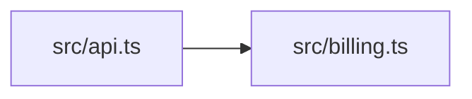
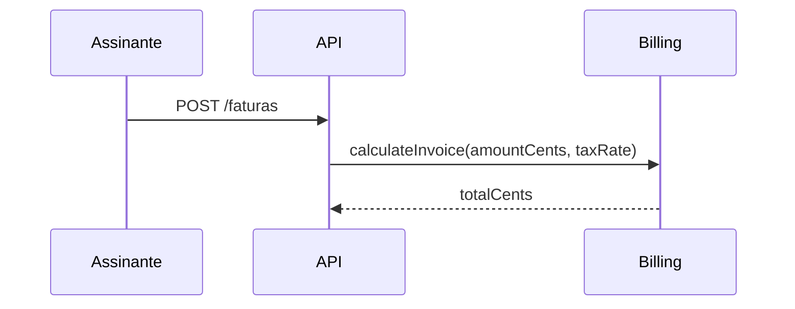

# Serviço de Faturamento — Documentação Viva

Módulo de cálculo de faturas do assinante com documentação sincronizada ao código.

## Funções públicas

- `calculateInvoice(amountCents, taxRate)` — calcula o valor final da fatura em centavos.
- `formatCharge(customerId, cents)` — formata o resumo da cobrança.
- `handleBillingRoute(customerId, amountCents)` — rota principal de faturamento.

## Diagrama de dependências

## Fluxo operacional

