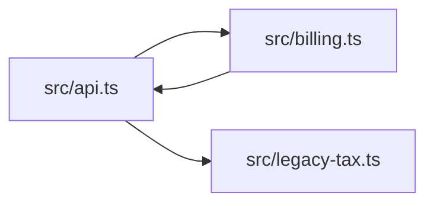

# Serviço de Faturamento — Documentação

Módulo de cálculo de faturas do assinante.

## Funções públicas

- `calculateInvoice(amountCents, taxRate, obsoleteDiscount)` — calcula a fatura aplicando o desconto legado `obsoleteDiscount`.
- `handleBillingRoute(customerId, amountCents)` — rota principal de faturamento.

## Diagrama de dependências



## Fluxo com erro de sintaxe Mermaid

```mermaid
flowchart TD
  Inicio["Receber pedido"] --->|fatura quebrada
```
